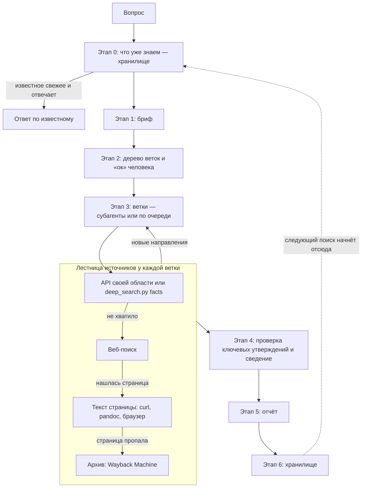
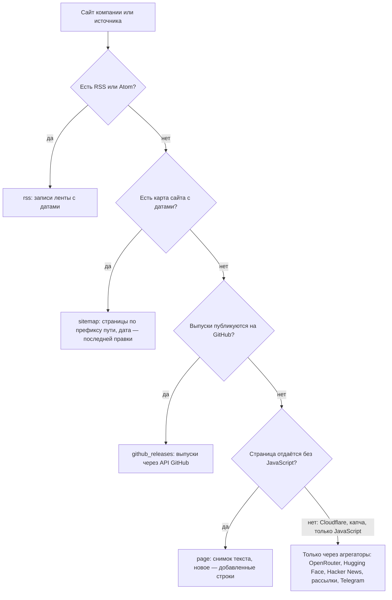

# deep-search: как устроен и как им пользоваться

Когда вы дочитаете руководство, у вас будет установлен скилл deep-search — набор инструкций для
ИИ-агента, программы вроде Claude Code, которая сама ищет в интернете и работает с файлами
(подробнее — раздел 1). С ним агент станет искать информацию по правилам, проверять найденное по
первоисточникам и сохранять результат так, чтобы следующий поиск начинался с уже известного. Вы
будете знать, что агент спросит, что покажет и где потом лежит результат.

Как читать. Чтобы просто начать пользоваться, хватит разделов 1, 2 и 10: зачем скилл, как выглядит
работа с ним и как его установить. Разделы 3–9 объясняют устройство: их можно читать выборочно,
когда станет интересно, почему агент делает именно так. Незнакомое слово ищите в словаре
(раздел 11). Каждый раздел начинается с того, зачем он нужен.

Статус: скилл и его скрипт написаны и проходят свои тесты, установка по разделу 10.1 работает, но на
настоящих задачах скилл ещё не опробован: бюджеты — сколько обращений к поиску и страницам агент
может потратить на один поиск (5.3) — и примеры могут измениться. Примеры помечены словом «пример»;
когда скилл опробуют на настоящих задачах, их заменят настоящие поиски. Руководство пересказывает
спецификации — документы разработки, где записаны все решения и почему они такие; для работы со
скиллом читать их не нужно. Основная — [спецификация](specs/2026-10-05-deep-search-design.md) от
2026-10-05; сбор новостей об ИИ, сводка о программе и знание об области ИИ (разделы 4.7, 9 и 10.5)
описаны в [спецификации](specs/2026-10-09-watch-design.md) от 2026-10-09.

## Оглавление

Разделы 1 и 2 помогают решить, нужен ли вам скилл. Разделы 3–9 объясняют, как он устроен, раздел
10 — как его установить и как им пользоваться, а словарь в конце — справка.

1. Зачем этот скилл — какие ошибки агент делает в поиске, что из них исправляет скилл и чего он не
   делает.
2. Как это выглядит со стороны — два примера работы со скиллом: быстрый вопрос и серьёзный поиск.
3. Общая схема: этапы 0–6 — весь поиск от вопроса до сохранения на одной схеме; на неё опираются
   разделы 4–6.
4. Подготовка: бриф — как агент записывает, что именно ищем, и какое знание о предметной области
   подключает.
5. Поиск: ветки, источники, проверка — как идёт поиск и почему найденному можно доверять.
6. Хранилище: найденное не теряется и не превращается в свалку — в какой папке лежит результат,
   как следующий поиск его использует и почему файлы не начинают противоречить друг другу.
7. Экономия контекста — почему скилл разбит на части и следит за размерами файлов.
8. Устройство репозитория: что где и зачем — каждый файл в папке скилла и зачем он; нужен, если
   будете что-то менять.
9. Скрипт `deep_search.py` — программа, которая проверяет файлы и собирает данные из сети: её
   команды и когда их запускать.
10. Как пользоваться — установка (10.1), первый поиск и типичные ситуации.
11. Словарь — термины руководства.

## 1. Зачем этот скилл

*Раздел объясняет, какую проблему решает скилл и где его границы. Без этого остальное выглядит
лишней сложностью.*

**Что такое агент и скилл.** ИИ-агент — например, Claude Code — отличается от чата тем, что сам
читает файлы, выполняет команды в терминале и ищет в интернете; на каждое такое действие он
спрашивает ваше разрешение, если вы не разрешили его заранее в настройках. Скилл — это набор
инструкций для агента в виде файлов: агент подгружает их, когда задача им подходит. deep-search —
инструкции о том, как искать информацию качественно. Сам по себе скилл ничего не ищет: он учит
агента порядку работы, а агент пользуется своими инструментами — веб-поиском, чтением страниц,
командной строкой и субагентами. Субагент — это помощник, которого агент запускает для отдельной
части работы: у помощника своя рабочая память, и он возвращает агенту только итог.

**Что идёт не так, когда агента просто просят «найди».** Исследования агентного поиска
(отчёт [02](../research/2026-10-05-search-landscape/02-research-studies.md)) показывают типичные
провалы:

- агент делает пару запросов и останавливается раньше времени — полноты нет;
- верит фрагменту текста в поисковой выдаче или пересказу страницы, а не самой странице. Даже у
  сильных систем источник подтверждает утверждение только в 39–77 % случаев, а 3–13 % ссылок
  выдуманы;
- не отличает рекламу вендора от документации и пять перепечаток одного пресс-релиза принимает за
  пять подтверждений;
- не помнит, что искали в прошлый раз, и каждый раз начинает с нуля;
- в большом поиске забивает свою рабочую память страницами и начинает ошибаться: чем больше
  действий в одном контексте, тем хуже точность цитат (−42 % при росте с 2 до 150 вызовов).

**Что делает deep-search.** Три части, и каждая закрывает свою группу провалов:

1. **Подготовка** — до поиска фиксируется бриф: что ищем, зачем, что считается ответом, в каких
   границах и с каким бюджетом — сколько действий агент может потратить. Агент не гадает, чего
   от него хотят.
2. **Поиск** — задача раскладывается на ветки, ветки работают параллельно, каждый источник и
   утверждение получают оценку надёжности, ключевые утверждения проверяет отдельный агент, а
   остановка подчиняется правилам, а не усталости.
3. **Сохранение** — найденное ложится в хранилище — папку с файлами на вашем диске, которую читают и
   человек, и агент. Следующий поиск начинает с того, что уже известно.

**Чего deep-search не делает.** Это границы первой версии: их стоит знать до установки, чтобы не
ждать от скилла лишнего.

- **Не следит за темами сам.** Мониторинг новинок ИИ — сбор свежих новостей из лент компаний и
  рассылок (10.5) — запускаете вы, расписания нет. Следить за темой, которую вы уже искали, скилл не
  умеет: её обновляет повторный поиск по вашей просьбе (10.3).
- **Не ищет по внутренним данным.** Например, поиск по спискам библиотек, из которых собраны ваши
  программы, — вне первой версии.
- **Не имеет своего поискового индекса.** Он пользуется веб-поиском агента и бесплатными API.
  Семантического поиска, как у платных сервисов, нет; сайты с защитой от роботов могут быть
  недоступны.
- **Не подключает платные поисковые сервисы по умолчанию.** Их можно добавить, когда появятся ключи
  (5.5).
- **Не принимает решений за вас.** Он собирает, проверяет и обосновывает сведения и предлагает
  кандидатов; выбирает человек.
- **Не коммитит.** Сохраняет изменения хранилища и проектов в истории git (коммитит) сам
  пользователь.
- **Не даёт юридической оценки** — в том числе того, можно ли хранить полные копии страниц.

## 2. Как это выглядит со стороны

*Раздел показывает работу скилла глазами пользователя, до любых подробностей: что вы просите, что
видите, что от вас нужно.*

Уровень (S, M, L или XL) говорит, сколько усилий агент потратит и сколько вашего участия нужно.
Называть его самим не обязательно: агент предлагает уровень по вашему вопросу, а вы можете его
изменить (раздел 4.5).

### 2.1. Быстрый вопрос — уровень S (пример)

Вы спрашиваете: «Под какой лицензией сейчас Redis и с какой версии?»

1. Агент пишет мини-бриф в три строки: вопрос, что будет ответом (лицензия, версия, дата), бюджет —
   до 15 действий.
2. Делает несколько запросов, открывает первоисточники — файл лицензии и заметки к выпуску.
3. Отвечает: «Redis 8 доступен и под AGPLv3; в 03.2024 проект перешёл на SSPL, AGPLv3 добавлен в
   05.2025» — со ссылками, датой проверки и кодом оценки `A1`. Код оценки показывает, насколько
   ответу можно верить: здесь он значит «взято из первоисточника и подтверждено» (шкала — в 5.6).

Ничего подтверждать не нужно: на уровне S агент сразу ищет. Сохранять ли ответ в хранилище, решаете
вы: если сохранять не нужно, так и скажите агенту, и в брифе появится `store: none`.

### 2.2. Серьёзный поиск — уровни M и L (пример)

Вы просите: «Нужно хранить журналы работы сервисов и искать по ним в контуре без интернета. Чем?»

1. **Что уже знаем.** Агент смотрит в хранилище: искали ли похожее, что тогда отвергли и почему.
2. **Бриф.** Агент заполняет всё, что может, и одним списком спрашивает недостающее. Например: какое
   решение будет принято по результату; без чего вариант точно не подходит; что используется сейчас;
   сколько усилий допустимо.
3. **План.** Агент показывает бриф и дерево веток. Ветка — часть поиска с одной целью, которую
   выполняет отдельный субагент; агент, который раздаёт ветки и сводит их итог, называется
   ведущим (5.1). Например: B1 — какими классами решений это
   вообще решают; B2 и B3 — реализации двух самых подходящих классов; B4 — неудачный опыт и уход с
   этих решений. Ждёт, пока вы ответите в чате «ок» или поправите план.
4. **Ветки.** Работают параллельно. Каждая пишет свои находки в файлы и возвращает ведущему агенту
   короткую выжимку.
5. **Проверка.** Отдельный агент с «чистой головой» проверяет ключевые утверждения по одному.
6. **Отчёт.** Ответ; кандидаты со ссылками и оценками; что отсеяно и почему; что не успели
   просмотреть; открытые вопросы.
7. **Сохранение.** Карточка темы, утверждения с цитатами, источники — в хранилище.

От вас нужно: ответить на вопросы, подтвердить бриф и план, прочитать отчёт. Если по ходу появится
развилка (например, оказалось, что задачу закрывает уже используемый инструмент), агент спросит.
Кроме того, агент может спрашивать разрешение на команды, которые не разрешены заранее в настройках
(10.1, шаг 8), например на `pandoc` или запуск скрипта скилла. Держите сессию открытой, пока не
придёт отчёт; если она всё же закрылась, поиск можно продолжить в новой (10.4).

Отчёт агент пересказывает в чате, а целиком он лежит в файле `runs/<дата>-<тема>/report.md` внутри
хранилища. Хранилищ два: библиотека — общая папка для всех ваших проектов — и папка `research/`
внутри проекта; куда сохранять, агент спросит вместе с брифом (раздел 6.1).

## 3. Общая схема: этапы 0–6

*Раздел даёт карту всего процесса: на неё опираются все следующие разделы.*

```text
0. Что уже знаем → 1. Бриф → 2. План дерева → «ок» человека → 3. Ветки ─┐
                                                       ↑                 │ раунды, пока
                                                       └── новые ветки ──┘ появляется новое
→ 4. Проверка и сведение → 5. Отчёт → 6. Сохранение
```

Почему именно такой порядок:

- **Хранилище — до брифа.** Чтобы не искать заново то, что известно, и не предлагать то, что уже
  отвергли.
- **Бриф — до поиска.** Требования, выданные по частям в ходе работы, ухудшают результат в среднем на
  39 % (отчёт [02](../research/2026-10-05-search-landscape/02-research-studies.md)).
- **План и «ок» — до веток.** Ветки — самая дорогая часть. Она начинается только после вашего
  согласия.
- **Проверка — отдельно от поиска.** Тот, кто нашёл, плохо проверяет сам себя. Свежий взгляд
  ловит ошибки.
- **Отчёт — до сохранения.** В хранилище попадает только проверенное и сведённое.
- **Сохранение — в конце.** Следующий поиск начнёт отсюда.

Уровень S проходит те же этапы, но коротко: этап 2 без веток, без подтверждения, сохранение — по
желанию.

**Как устроен поиск** — та же схема подробнее: откуда ветка берёт сведения. Каждая ветка идёт по
лестнице источников своей области сверху вниз и спускается, только если ступень выше не дала
ответа (раздел 5.5). На GitHub схема показывается рисунком, в редакторе читается как текст.



## 4. Подготовка: бриф

*Раздел объясняет первую часть скилла: как фиксируется, что именно мы ищем.*

Раздел состоит из семи частей:

1. Зачем бриф (4.1) — что идёт не так без него.
2. Как бриф появляется (4.2) — что агент заполняет сам, о чём спрашивает и что показывает вам.
3. Поля по группам (4.3) — что записывается в бриф.
4. Семь типов вопроса (4.4) — главное поле: от него зависит, как устроен поиск.
5. Уровни S, M, L, XL (4.5) — сколько усилий потратить и сколько нужно вашего участия.
6. Вопросы, которые может задать агент (4.6) — к чему готовиться.
7. Пресет (4.7) — какое знание о предметной области подключает поле `preset`.

### 4.1. Зачем бриф

Бриф — это техническое задание на поиск. Без брифа агент сам додумывает, что вам нужно, и
додумывает по-своему. С брифом есть точка отсчёта: по нему
строится план, на него оглядываются в ходе поиска, по нему проверяется итог. Так же работают
профессии, где поиск — ремесло: систематические обзоры в науке, разведка, библиотечное дело (отчёт
[08](../research/2026-10-05-search-landscape/08-systematic-methods.md)).

### 4.2. Как бриф появляется

1. Агент заполняет всё, что может, сам: из вашей просьбы и из хранилища.
2. Недостающее спрашивает одним списком, а не по одному вопросу.
3. Пересказывает бриф одним абзацем — проверить, правильно ли понял.
4. Начиная с уровня M ждёт «ок».
5. Если по ходу что-то меняется, это записывается в раздел «Поправки»: что, когда и почему. В
   полях остаётся новое значение, история — только в «Поправках».

На уровне S бриф — мини-бриф из трёх строк, без веток и без «ок». С уровня M агент показывает бриф
вместе с планом дерева, уровнем и бюджетом и тем, куда сохранит итог (контрольная точка 0). Если
ответить некому, агент записывает допущения в `assumptions` и «Поправки» и продолжает.

Бриф — файл `brief.md` в папке поиска. Сверху — поля в формате YAML между двумя строками `---`
(такой блок называют frontmatter), ниже — разделы «Пересказ» и «Поправки». Имена полей английские,
значения — на любом языке. Писать бриф руками не нужно: его заполняет агент, а вы проверяете.

### 4.3. Поля по группам

Полей около сорока. Обязательны не все: что именно обязательно, зависит от уровня и типа вопроса.
Ниже — зачем каждая группа и что в ней главное.

**Зачем ищем** — чтобы агент понимал цель, а не только слова запроса.

| Поле | Простыми словами | Зачем |
|---|---|---|
| `id`, `request_ref` | имя поиска и ссылка на исходную просьбу | чтобы найти бриф и понять, откуда он |
| `question` | главный вопрос одной фразой | точка отсчёта; формулируется через задачу: «хранить журналы и искать по ним», а не «нужен аналог Elasticsearch» — иначе поиск сразу сужается до известного |
| `decision_context` | какое решение примут по результату, кто и когда | задаёт глубину и форму ответа |
| `question_type` | тип вопроса — 7 вариантов (4.4) | от него зависит форма поиска |
| `mode` | новый поиск или обновление прежней темы | обновление ищет только новое |
| `stakes` | цена ошибки: низкая, обычная, высокая | чем выше, тем строже подтверждение |

**Что считается ответом** — чтобы агент знал, когда остановиться и что выдать.

| Поле | Простыми словами | Зачем |
|---|---|---|
| `done_criteria` | 3–8 пунктов: каким должен быть ответ; на уровне S — одна строка | по ним проверяется итог |
| `coverage_goal` | первый годный ответ, представительная выборка или всё, что есть | от этого зависят правила остановки |
| `output_format` | в какой форме нужен ответ: таблица, список, короткий вывод | форма отчёта |
| `if_not_found` | что делать, если данных нет | по умолчанию — честно «не найдено» и что пробовали, без догадок |

**Предмет и критерии** — что подходит, а что нет.

| Поле | Простыми словами | Зачем |
|---|---|---|
| `concept`, `subject` | что ищем и для каких условий | область поиска |
| `inclusion_criteria` | без чего вариант не подходит | фильтр: «обязательные функции» |
| `exclusion_criteria` | что сразу исключает | «жёсткие ограничения»: работа без интернета, лицензия и т. п. |
| `baseline` | что есть сейчас или «ничего не менять» | с чем сравнивать |
| `comparison_criteria` | по каким признакам «лучше» | для сравнений |
| `data_items` | что выяснить по каждому найденному | лицензия, поддержка, версия… |
| `current_assets` | что у вас уже есть | вдруг задачу закрывает имеющееся |
| `known_items` | варианты, которые вы уже знаете | точки старта и тест полноты: хороший поиск их находит |
| `hypotheses` | конкурирующие ответы | для проверки «правда ли, что…» |
| `assumptions` | допущения | незаданное помечается «без ограничения», а не выдумывается |
| `type_data` | данные своего типа вопроса | что заменяем и к какому сроку; текст требования |

**План поиска** — где и как искать.

| Поле | Простыми словами | Зачем |
|---|---|---|
| `sub_questions` | подвопросы — будущие ветки | у каждого статус покрытия: не закрыт, частично, закрыт (0, 0,5, 1) |
| `perspectives` | 3–6 точек зрения (эксплуатация, безопасность, критик…) | запросы получаются разнообразнее |
| `keywords` | слова и синонимы на русском и английском | без них поиск находит только очевидное |
| `sources_plan` | обязательные, желательные, запрещённые источники | откуда брать и чему не верить |
| `limits`, `as_of_date` | языки, период, география; на какую дату нужны сведения | границы |
| `prior_work`, `exclusions` | что уже искали и что отвергли | заполняется из хранилища |

**Бюджет и остановка** — сколько усилий потратить: `budget_tier` (уровень S–XL), `budget`
(действия, время, срок), `stop_rule` (когда хватит), `min_confirmation` (сколько подтверждений
нужно ключевым утверждениям). Значения по умолчанию берутся от уровня и от `stakes`.

**Хранение и ограничения:**

- `store` — куда сохранить: в общую библиотеку, в проект или никуда (последнее — только для S);
- `store_topic` — тема в хранилище;
- `report_path` — куда положить копию отчёта;
- `disclosure_constraints` — что нельзя отправлять во внешние сервисы;
- `preset` — пресет: файл со знанием об одной предметной области — где там первоисточники и какими
  словами искать, например `technology` (4.7).

### 4.4. Семь типов вопроса

Тип вопроса — главное поле брифа: от него зависит, как будет устроен поиск (раздел 5.2).

| Тип | Когда | Пример |
|---|---|---|
| `fact` | один проверяемый факт | «Под какой лицензией Redis?» |
| `validation` | правда ли утверждение; какая из гипотез верна | «Правда ли, что X работает без интернета?» |
| `comparison` | сравнить известные варианты | «A или B для нашей задачи?» |
| `options` | найти варианты решения задачи | «Чем хранить журналы и искать по ним?» |
| `exhaustive_list` | полный перечень по критериям | «Все открытые решения класса X с установкой у себя» |
| `replacement` | замена известного решения | «У X кончается поддержка — на что переходить?» |
| `compliance` | что закрывает требования документа | «Что закрывает пункты требования такого-то?» |

### 4.5. Уровни S, M, L, XL

Уровень задаёт, сколько усилий потратить и сколько вашего участия нужно.

| Уровень | Когда | Ветки | Действий всего | Ваше участие |
|---|---|---|---|---|
| S | быстрый вопрос, один факт | 0–1 | до 15 | никакого: агент сразу ищет |
| M | сравнение, проверка, замена, требования | 2–4 | 30–60 | подтвердить бриф и план |
| L | поиск вариантов, перечень | 3–5, 1–2 круга | 60–120 | то же и промежуточная сверка |
| XL | большой исчерпывающий перечень | 5–10, не больше 20 | 100–200 | то же |

Уровень по умолчанию агент предлагает по типу вопроса: `fact` — S; проверка, сравнение, замена,
требования — M; варианты и перечень — L; исчерпывающий перечень больше 50 объектов — XL. Вы можете
изменить уровень. Числа стартовые, их уточнят первые реальные поиски.

### 4.6. Вопросы, которые может задать агент

Агент задаёт только те, ответов на которые нет в просьбе и в хранилище:

1. Какое решение будет принято по результату и кем?
2. Что для вас «ответ»: список, одна рекомендация, сравнение, да/нет? Сколько вариантов?
3. Где уже искали, что нашли и отвергли, почему?
4. Что используется сейчас и чем не устраивает?
5. Без чего вариант не подходит, а что его сразу исключает?
6. Какие подходящие примеры вы уже знаете?
7. Какие слова должны встретиться в результатах, как это называют специалисты, на каких языках?
8. Насколько свежими должны быть сведения, каким источникам не доверять?
9. К какому сроку нужен результат и сколько усилий допустимо?
10. Что нельзя упоминать в запросах к внешним сервисам?

Отвечать можно коротко. «Не знаю» — тоже ответ: агент запишет допущение и продолжит.

### 4.7. Пресет: знание о предметной области

Поле брифа `preset` подключает к поиску пресет; агент выбирает его сам по вашему вопросу, а вы
видите выбор в брифе и можете поправить. **Пресет** — файл с «картой местности» для одной области:
где там первоисточники, какие каталоги дают охват, какими словами искать, на что смотреть при
оценке, какие ловушки. Общий метод от пресета не меняется, пресет только дополняет его. Пресет
читается, только если указан в брифе, поэтому знание о технологиях не мешает поиску о чём-то другом.

**`technology`** — первый пресет. Что в нём:

- какие задачи поиска технологий каким типом вопроса решаются;
- первоисточники ПО по шкале надёжности (5.6): код, документация версии, журнал изменений, трекер
  ошибок;
- источники охвата: ландшафты технологий, подборки открытого кода, каталоги альтернатив, реестр
  российского ПО, реестр сертифицированных средств защиты, сроки поддержки версий;
- шаблоны запросов по назначениям — классы решений, реализации, альтернативы, переход, неудачный
  опыт, опыт эксплуатации, сроки и лицензия, аналоги; каждый шаблон дан в двух вариантах, английском
  и русском, и запрос выполняется на обоих языках;
- расширение по связям: от найденного к альтернативам, переходам, форкам и соседям по каталогу;
- **лестница замены** — пять ступеней от дешёвого перехода к дорогому: поддерживаемая версия, форк
  или преемник, другие реализации того же интерфейса, отечественные аналоги, технологии другого
  класса; мерило — возможности, которые вы реально используете;
- **порядок для требований** — от текста требования к матрице «положение → чем закрывается» и
  поиску только по незакрытым положениям; спорное толкование подтверждает человек;
- причины отсева и откуда брать данные для оценки: зрелость проекта, безопасность, стоимость
  владения и выхода;
- признаки за и против, подсказки для жёстких ограничений, классы свежести, разделы отчёта.

**`ai`** — второй пресет: поиск в отрасли ИИ. Что в нём:

- какой тип вопроса у типичных задач: сравнить модели — `comparison`, чем заменить модель —
  `replacement`, выбрать инструмент для агента или программу для ИИ — `options`, правда ли, что
  поставщик изменил цену или лимит, — `validation`; «что нового» — не поиск, а сценарий 10.5;
- первоисточники по шкале надёжности (5.6): карточка модели, документация API, страница цен, журнал
  изменений — A (о фактах о себе); независимые оценки с открытой методикой (Epoch AI) — B; LMArena —
  C; OpenRouter, рассылки, Telegram — D; бенчмарки вендора о себе и маркетинг — E;
- источники охвата: OpenRouter, Hugging Face, данные LMArena, каталоги Epoch AI, рассылки, найденное
  командой `watch` (9.1) и прежние дайджесты библиотеки;
- шаблоны запросов на английском и русском: выход модели, сравнение, цены и лимиты, отключение
  модели, опыт использования, альтернативы программе;
- ловушки: выборочные бенчмарки вендора, утечка тестов в обучающие данные, дата в OpenRouter — не
  дата выхода, preview и общая доступность, цены по длине контекста и режиму, доступность по
  регионам;
- что сравнивать у моделей и как быстро устаревают сведения: цены и лимиты — быстрее всего.

Набор лент для `watch` (`presets/ai-feeds.json`) лежит рядом с пресетом, но читается не агентом, а
скриптом (5.5, 9.1).

**Как добавить свой пресет** (например, для науки или нормативных документов): новый файл
`presets/<имя>.md` с теми же разделами, не больше 12 тысяч символов, и значение `preset: <имя>` в
брифе. Размер проверит команда `self` скрипта `deep_search.py` (раздел 9).

## 5. Поиск: ветки, источники, проверка

*Раздел объясняет вторую часть скилла: как идёт сам поиск и почему ему можно доверять.*

Раздел состоит из десяти частей:

1. Ветки (5.1) — на какие части агент делит поиск и почему.
2. Какое получится дерево (5.2) — как деление зависит от типа вопроса.
3. Сколько веток и сколько усилий (5.3) — как считается бюджет.
4. Что делает ветка (5.4) — задание, порядок работы и что она возвращает.
5. Какие источники и почему (5.5) — где агент ищет и что не взяли.
6. Как оцениваются источники и утверждения (5.6) — шкала надёжности, на которую опирается всё
   остальное.
7. Когда ветка и поиск останавливаются (5.7) — правила остановки.
8. Проверка и сведение (5.8) — как ключевые утверждения проверяются и собираются в ответ.
9. План, журнал и отчёт (5.9) — какие файлы остаются после поиска.
10. Когда агент спросит вас (5.10) — где нужно ваше участие.

### 5.1. Ветки: что это и зачем

**Ветка** — часть поиска с одной целью. Её выполняет отдельный агент-помощник (субагент) со своей
рабочей памятью. Агент, который ведёт весь поиск, называется **ведущим**: он пишет бриф, строит
план, раздаёт ветки, сводит результаты.

Зачем ветки:

- **быстрее** — ветки идут параллельно;
- **чище** — каждая ветка работает в своей рабочей памяти, ведущий не тонет в сотнях страниц и
  получает только короткие выжимки;
- **полнее** — разные ветки смотрят на задачу с разных сторон.

Когда веток нет: простой факт; цепочка, где следующий шаг зависит от предыдущего; задача, в которой
важно качество источников, а не охват. Ветвление стоит дорого: работа нескольких агентов
расходует примерно в 15 раз больше токенов, чем обычный чат, а на цепочках оно вредит. Токен —
единица текста, которой модель считает прочитанное и написанное (слово или его часть); от числа
токенов зависят цена работы и то, сколько помещается в рабочую память агента (отчёт
[07](../research/2026-10-05-search-landscape/07-branching-budget.md)).

Если агент не умеет запускать помощников (например, Codex или модель, развёрнутая в закрытом
контуре), ветки идут по очереди — с теми же файлами и правилами, просто дольше.

### 5.2. Какое получится дерево

Ведущий делит поиск на ветки. Если нарисовать, на какие части разбита задача, получится дерево.
Его форма зависит от типа вопроса — главного поля брифа (4.4): для каждого типа своё правило,
как нарезать ветки.

| Тип | Пример вопроса | Какие будут ветки |
|---|---|---|
| `fact` | «Под какой лицензией Redis?» | Веток нет, ведущий ищет сам. Если факт трудный, он делает 2–3 независимые попытки и сверяет ответы |
| `validation` | «Правда ли, что X работает без интернета?» | Ветка на каждую гипотезу: «да» и «нет». Надёжность источников важнее их числа |
| `comparison` | «PostgreSQL или MySQL для нашей задачи?» | Ветка на каждый вариант. Все сравнивают по одному общему списку критериев, иначе результаты не сопоставить |
| `options` | «Чем хранить журналы и искать по ним?» | Два шага. Сначала — какие бывают классы решений: поисковый движок, колоночная база данных и так далее. Потом ветка на каждый класс — найти конкретные продукты |
| `exhaustive_list` | «Все открытые решения класса X с установкой у себя» | Перечень делится на части, каждая часть — ветка. Все ветки одинаково решают, что считать дублем. В конце — контрольная проверка: не пропущено ли что-то |
| `replacement` | «У X кончается поддержка — на что переходить?» | Ветки идут по «лестнице» от самого дешёвого перехода к самому дорогому: поддерживаемая версия того же → форк или преемник → другая реализация того же интерфейса → отечественный аналог → решение другого класса |
| `compliance` | «Что закрывает пункты требования такого-то?» | Требование разбирается на пункты (положения). Каждый пункт, который ещё не закрыт, ищется отдельно. Итог — таблица «положение → чем закрывается» |

Типы `options`, `replacement` и `compliance` придуманы для поиска технологий, но годятся для
любой темы.

### 5.3. Сколько веток и сколько усилий

Усилия считаются в **вызовах**: вызов — одно обращение наружу (поиск, открытие страницы или PDF,
запрос к API). Сколько их у ветки, видно по её журналу: строка журнала — один вызов.

Число веток задаёт уровень, а форму — тип вопроса (5.2):

| Уровень | Ветки | Вызовов на ветку: пора сворачиваться / стоп | Вызовов всего |
|---|---|---|---|
| S | 0–1 | 3–10 / 15 | до 15 |
| M | 2–4 | 10–15 / 20 | 30–60 |
| L | 3–5, 1–2 круга | 10–15 / 20 | 60–120 |
| XL | 5–10, не больше 20 | до 15 / 20 | 100–200 |

- Одновременно работают не больше 5 веток; на одном уровне дерева — не больше 7, иначе их
  группируют; на весь поиск — не больше 20, иначе план перестраивают.
- Глубина — не больше двух кругов расширения: ветки следующего круга рождаются из находок
  предыдущего, и их вдвое меньше, но не меньше двух. Третий круг — только отдельным решением, если
  новое продолжает прибывать.
- Бюджет делится примерно так: 55–60 % — найти, 25–30 % — проверить по первоисточникам, 15 % —
  свести.
- Ветки, которые приносят меньше среднего, закрываются, их бюджет переходит лидерам.
- На 80 % бюджета новых веток не открывают, а работающие сворачиваются.
- У Claude Code есть предел — 200 веб-поисков на сессию вместе с помощниками. Ведущий считает их в
  плане прогона; ближе к 160 переходит на API и прямую загрузку страниц или предлагает продолжить в
  новой сессии: там достаточно попросить агента продолжить этот поиск, и он начнёт с файла `plan.md`
  (5.9). Упереться в предел может только XL.

Числа стартовые: их уточнят первые реальные поиски.

### 5.4. Что делает ветка

Ветка получает задание. В нём: общая цель поиска, её собственная цель, какой нужен ответ, когда
хватит, чем заняты соседние ветки (чтобы не дублировать), откуда начинать, бюджет и куда писать
находки. Задание самодостаточно: помощник не видит вашего разговора с ведущим, поэтому всё нужное
передаётся в задании.

Дальше ветка работает в четыре прохода:

1. **Пробный поиск** — понять, как об этом пишут, и собрать термины.
2. **Охват** — каталоги, обзоры, подборки: найти как можно больше кандидатов.
3. **Проверка по первоисточникам** — каждую находку проверить по самому надёжному источнику.
4. **Расширение по связям** — от найденного к соседнему: альтернативы, на что и с чего переходят,
   форки и преемники, соседи по каталогу. Круги повторяются, пока появляется новое.

Обязательные приёмы — их ветка делает всегда:

- **ищет опровержение** к каждому ключевому выводу: неудачный опыт, разборы отказов, «почему мы
  отказались от X»;
- **проверяет, нет ли решения у вас** — вдруг задачу закрывает уже используемое;
- **сверяется с прежними решениями** — отвергнутое не исследуется заново, но новые сведения о нём
  отмечаются.

Запросы короткие (2–5 слов), на русском и английском. Повтор запроса — признак, что ветка ходит по
кругу: тактику меняют. Пустая выдача — повод переформулировать, а не написать «данных нет».

**Как ветка достаёт текст.** Встроенные инструменты агента ограничены (отчёт
[01](../research/2026-10-05-search-landscape/01-tools-products.md)): веб-поиск Claude Code
возвращает только заголовки и ссылки, а инструмент чтения страниц — пересказ маленькой моделью, а не
сам текст. Поэтому порядок такой:

1. Сначала специализированные источники: документация библиотек (сервис context7), GitHub, каталоги
   пакетов, базы уязвимостей, научные базы — они дают точные данные без «шума». Какие именно и
   почему — 5.5.
2. Обычный веб-поиск — чтобы найти ссылки.
3. Полный текст страницы — через командную строку (curl с конвертером в текст, извлечение текста из
   PDF, безголовый браузер для страниц на JavaScript). Только из полного текста берутся цифры и
   цитаты.
4. Пересказ страницы — только чтобы решить, стоит ли её открывать.
5. Мёртвую ссылку проверяют в веб-архиве: устарела она или выдумана.

Ветка пишет журнал — что искала, где, сколько просмотрела, что нашла — и **улики**: строки вида
«источник, место, цитата, оценка, происхождение». Дата в улике — дата проверки, то есть когда ветка
прочитала страницу; дата публикации источника пишется рядом с происхождением, а если её нет —
«б/д».

Ветка оценивает то, что видит сама: ставит букву надёжности каждой улике, а своим утверждениям —
предварительную оценку и класс свежести (5.6). Окончательную оценку ставит ведущий при сведении:
только он видит все ветки и может понять, что две находки восходят к одному источнику.

Ведущему ветка возвращает короткий ответ: не больше 1,5 тысячи токенов и путь к своим файлам. В
ответе — находки с оценками, что отсеяно и почему, что не нашлось, куда стоит копать дальше и,
если вы назвали известные примеры, сколько из них ветка нашла сама (например, «4 из 5»).

### 5.5. Какие источники и почему

**Как отбирали.** Источник попадает в набор, если отвечает трём требованиям:
- даёт первоисточник или точные данные, а не пересказ;
- работает бесплатно и без ключа;
- не отправляет запрос третьей стороне без нужды. Это важно, когда сама тема поиска непублична: что
  нельзя называть внешним сервисам, задаёт поле брифа `disclosure_constraints`.

Набор собран по обзору инструментов (отчёт
[01](../research/2026-10-05-search-landscape/01-tools-products.md)) и проверен запросами к самим
источникам ([проверка 2026-10-09](../research/2026-10-09-sources-check/README.md)). Набор не
окончательный и пополняется по итогам реальных поисков.

Источники разделены на группы по тому, на какой вопрос они отвечают. Внутри поиска группы работают
по очереди: веб-поиск и каталоги находят кандидатов, специализированные источники дают точные
данные о них, инструменты чтения достают текст для цитаты.

#### Найти, где искать

Эти источники ничего не подтверждают. Они отвечают на вопрос «что вообще существует и где об этом
написано»: дают ссылки и названия, которые потом проверяются по первоисточникам.

| Источник | Для чего |
|---|---|
| WebSearch — встроенный веб-поиск Claude Code | найти страницы по запросу. Отдаёт только заголовки и ссылки, не больше 200 вызовов на сессию |
| Каталоги и подборки из пресета: ландшафты технологий, awesome-списки, темы GitHub, AlternativeTo | увидеть всё поле сразу: какие есть решения данного класса и что предлагают вместо известного (раздел 4.7) |
| Хабр, доклады конференций, разборы опыта | узнать, какие классы решений бывают и как они ведут себя в работе. Опыт эксплуатации — уровень C |
| Wikidata | сверить простой факт — лицензию, дату выпуска, разработчика — с другими источниками. Это вики: указатель, а не подтверждение |

#### Программы: что это и как устроено

Ответ «из первых рук»: что программа умеет, под какой она лицензией, когда вышла версия. Здесь
получаются оценки уровня A.

| Источник | Для чего |
|---|---|
| context7 | сервис документации библиотек: агент обращается к нему через MCP-сервер, если тот подключён, или напрямую по API. Даёт документацию библиотеки нужной версии: как ею пользоваться, какие есть параметры. Точнее веб-поиска, потому что отдаёт фрагменты именно по версии и теме; цитата берётся со страницы, откуда взят фрагмент |
| GitHub: API и файлы репозитория | лицензия, выпуски, активность, сам код. Первоисточник для большей части открытого ПО. Без токена — 60 запросов в час, с токеном — 5 000 |
| Другие хостинги кода: GitLab, Codeberg и любые на Forgejo или Gitea, Gitee | то же для проектов, которые живут не на GitHub. Без токена запросов немного — хватает на точечные проверки |
| Поиск по чужому коду: GitHub (с токеном), grep.app, Sourcegraph | как библиотекой пользуются на деле и кто её использует — по коду публичных репозиториев |

#### Программы: можно ли на них опираться

Одна и та же программа может быть хорошей, но заброшенной, уязвимой или с кончающейся поддержкой.
Эта группа отвечает на вопрос «не подведёт ли она через год». Все источники — открытые базы с API:
данные точные и одинаковые для всех.

Главное из этой группы и из API хостинга кода собирает одна команда — `deep_search.py facts`
(раздел 9): лицензия, выпуски, последний коммит, уязвимости, сроки поддержки, загрузки, оценка
сопровождения, дистрибутивы — у каждого значения адрес запроса и путь к полю. Ветка начинает с неё,
а к источникам ниже обращается за тем, чего в сводке нет.

| Источник | Для чего |
|---|---|
| endoflife.date | до какого числа поддерживается версия. Сроки сотен продуктов в одном формате |
| OSV | известные уязвимости конкретной версии пакета. Сводит несколько баз; пустой ответ не значит «уязвимостей нет» — базы пополняются с задержкой |
| deps.dev | версии, лицензии и уязвимости пакетов npm, PyPI, Go, Maven, Cargo, NuGet — один API вместо отдельного для каждого реестра |
| ecosyste.ms | сколько скачивают и сколько проектов зависят от пакета — пользуются ли им на деле |
| OpenSSF Scorecard | как сопровождается проект: есть ли ревью кода, регулярные выпуски, защита веток. Готовая проверка вместо ручной |
| Repology | в каких дистрибутивах Linux и репозиториях пакетов есть программа и какой версии — легко ли её поставить |
| Реестры из пресета: российского ПО, сертифицированных средств защиты ФСТЭК | можно ли использовать там, где это требуется по закону |

#### Опыт и обсуждения

Как программа ведёт себя у других: что ломается, на что жалуются, почему от неё отказались. Отсюда
берутся ответы на запрос-опровержение. Это опыт людей, уровень C: не измерение и не первоисточник.

| Источник | Для чего |
|---|---|
| Hacker News | обсуждения разработчиков с рейтингом; опыт обычно в комментариях, а не в самой статье |
| Stack Exchange (Stack Overflow) | конкретные проблемы и их решения. Без ключа — 300 запросов в сутки |

#### Наука

Статьи и их судьба: кто что опубликовал, на что ссылаются, не отозвана ли работа.

| Источник | Для чего |
|---|---|
| OpenAlex | найти работы по теме и отсортировать по цитированиям: открытый каталог почти всей научной литературы |
| arXiv | препринты: работы по ИИ и смежным областям появляются там раньше всего. Препринт ещё не прошёл рецензию, поэтому без открытых данных — не выше C |
| Crossref | официальные сведения о статье по DOI и уведомления об отзыве: отозванную статью скилл не использует |
| Unpaywall | найти легальную открытую копию статьи по DOI, чтобы цитировать текст, а не аннотацию. Нужен настоящий адрес почты того, кто запускает |
| Europe PMC | биомедицина: статьи и признак открытого доступа |

#### Нормативные акты

| Источник | Для чего |
|---|---|
| pravo.gov.ru — официальное опубликование | найти акт и дату его официальной публикации — это первоисточник. Пресета для нормативки пока нет, но источник уже доступен |

#### Инструменты чтения

Это не источники, а способ достать текст. Нужны, потому что встроенные средства агента дают либо
только ссылки, либо пересказ, а число и цитата берутся только из настоящего текста.

| Инструмент | Для чего |
|---|---|
| curl + pandoc, pdftotext, безголовый Chromium | полный текст обычной страницы, PDF, страницы на JavaScript. Работает на своей машине |
| Jina Reader | запасной путь для сложных страниц, без ключа. Адрес страницы уходит стороннему сервису, поэтому — только если бриф это разрешает |
| WebFetch — встроенное чтение страниц Claude Code | только решить, стоит ли открывать страницу: отвечает малая модель, сам текст она не отдаёт |
| Wayback Machine | открыть пропавшую страницу из архива и понять, устарела ссылка или выдумана |

#### Новинки ИИ

Чтобы быть в курсе отрасли, нужны другие источники: не «что известно о X», а «что появилось за
последние дни». Их читает команда `deep_search.py watch` (разделы 9 и 10.5): скачивает ленты,
отбрасывает то, что видела в прошлые разы, склеивает одну новость из разных лент в одну запись и
грубо отбирает по словам интересов. Всё это делает код, без модели: агент тратит токены только на
новое, когда пишет дайджест. Готовый набор — 68 лент в скилле (`presets/ai-feeds.json`), проверены
2026-10-09: отдаются без ключа, без входа и без браузера. Свои ленты и отключения — в библиотеке.

**Как `watch` читает сайт.** У каждого сайта берётся самый надёжный машинный канал, который у
него есть. Способ чтения называется типом ленты; новая лента известного типа — одна строка в
наборе, новый тип — только кодом.



| Тип | Что читает |
|---|---|
| `rss` | RSS и Atom: блоги, рассылки, блоги компаний на Хабре, Reddit. Лента, которая вместо XML отдаёт HTML-страницу, считается не ответившей |
| `sitemap` | карта сайта: страницы нужных разделов по началу пути. Дата в карте — последней правки, поэтому старая страница после правки может всплыть как новая |
| `github_releases` | выпуски репозитория через API GitHub. Без токена — 60 запросов в час, с `GITHUB_TOKEN` — 5 000 |
| `hf_trending`, `hf_papers` | модели в тренде Hugging Face, созданные за последние дни; статьи недели, за которые проголосовали от 100 человек |
| `openrouter` | каталог моделей OpenRouter: новые по дате появления в каталоге — она не совпадает с датой выхода модели |
| `hn` | Hacker News по запросам о моделях и агентах, обсуждения от 100 очков |
| `telegram` | публичный канал через веб-версию `t.me/s/<канал>`, без входа |
| `page` | страница без ленты, обычно журнал изменений документации: новое — строки, которых не было в прошлый раз. Даты у такой записи нет — ставится время опроса, первый запуск только запоминает страницу |

**Первоисточники: компании.** По ним новость подтверждается — для фактов о себе это уровень A.

- Своя лента или карта сайта с датами: Anthropic, OpenAI, Google (DeepMind, блог об ИИ, блог для
  разработчиков), Mistral, Cohere, Z.ai, Microsoft AI и Azure, AWS и Amazon Science, NVIDIA,
  Hugging Face, Meta (инженерный блог). Яндекс и Сбер — через свои блоги на Хабре.
- Журналы изменений документации — снимком страницы: API Anthropic, OpenAI (и список моделей),
  Gemini API, Mistral, xAI, DeepSeek, Kimi, MiniMax, GigaChat; новости Яндекса. Так видны и
  компании, у которых своей ленты нет: сайт xAI закрыт Cloudflare, у DeepSeek и MiniMax ленты нет.
- Выпуски на GitHub: Claude Code, Codex, Gemini CLI, Qwen Code, Kimi CLI, SDK xAI, модели Llama,
  GigaChat, transformers (по нему видна поддержка новых архитектур моделей).
- Блог Qwen работает только на JavaScript, блог Meta AI закрыт для роботов: эти новости видны по
  выпускам на GitHub, по OpenRouter и Hugging Face.

**Сеть: агрегаторы и рассылки по всей отрасли.** Через них видно, *что* вышло, у кого бы ни вышло.
Для фактов — уровень D: новость подтверждается по первоисточнику.

| Источник | Для чего |
|---|---|
| OpenRouter, каталог моделей | почти каждая модель с API появляется здесь вскоре после выхода: дата появления, цена, длина контекста |
| Hugging Face: модели в тренде, статьи недели | новые открытые модели, которые люди действительно скачивают, и статьи, за которые голосуют. Сортировка просто по дате бесполезна — там в основном мусор |
| Hacker News | что обсуждают разработчики; рейтинг обсуждения — сигнал, что новость важна, а не только громкая |
| Reddit r/LocalLLaMA, лучшее за неделю | открытые модели глазами тех, кто запускает их у себя. Не чаще запроса в минуту |
| Рассылки обозревателей: Simon Willison, Import AI, Interconnects, Latent Space и её ежедневный AINews, The Batch | отбор и разбор от людей, которые читают отрасль целиком, включая X и Discord |

Ленты arXiv по разделам не читаются: в них сотни статей в день без отбора, а заметные статьи
приходят через статьи недели Hugging Face. Рейтинг LMArena и каталоги Epoch AI — не новости, а
данные для сравнения моделей: они в пресете `ai` (раздел 4.7).

**Чего не достать самим.** Многое лаборатории первыми публикуют в X (Twitter) и Discord, а туда без
входа и платного API не попасть. Здесь нужен внешний источник: авторские каналы и рассылки, которые
эти места читают и ставят ссылки. Новостные каналы, которые пересказывают открытые ленты, не нужны:
эти ленты `watch` читает сам. В наборе 12 авторских Telegram-каналов, все «на пробу»: `watch`
считает, сколько новостей канал дал первым и сколько — только он, и через 8 запусков без своего
предлагает его отключить. Отрасль в основном англоязычная, поэтому русскоязычные источники нужны
прежде всего для новостей Яндекса и Сбера.

**Когда лента ломается.** Сайты меняют адреса и разметку. Лента, которая не ответила или прислала
не то, не ломает запуск — она попадает в строку «не ответили»; после трёх провалов подряд `watch`
помечает её «проверить или отключить». Решает человек.

#### Что покрыто, а что нет

| Область | Чем покрыта | Чего нет |
|---|---|---|
| Открытое ПО на GitHub | хорошо: GitHub, документация, все источники группы «можно ли опираться» | — |
| Открытое ПО вне GitHub | Codeberg и другие хостинги на Forgejo и Gitea, GitLab, Gitee — без токена немного запросов | GitFlic — API только с токеном |
| В каких дистрибутивах есть пакет | Repology | — |
| Коммерческое и закрытое ПО | сайт вендора (A — о фактах о себе, E — об оценках себя), обзоры и опыт через веб-поиск | независимых измерений, кроме найденных поиском |
| Документация библиотек | context7 | — |
| Уязвимости, сроки поддержки, зрелость пакетов | OSV, endoflife.date, deps.dev, ecosyste.ms, Scorecard | уязвимостей, которых ещё нет в базах |
| Код в чужих репозиториях: кто и как использует | поиск по коду GitHub (с токеном), grep.app, Sourcegraph | без токена GitHub; у Sourcegraph анонимный доступ не задокументирован |
| Опыт эксплуатации, обсуждения, «почему отказались» | веб-поиск, Hacker News, Stack Exchange (300 запросов в сутки без ключа) | Reddit — только медленная лента, раз в минуту |
| Справочные факты: лицензия, дата выпуска, разработчик | Wikidata | — |
| Научные статьи | OpenAlex, arXiv, Crossref; Unpaywall — открытая копия статьи по DOI; Europe PMC — биомедицина | текста платных статей без открытой копии |
| Российская наука | только веб-поиск | КиберЛенинка — поиск закрыт для роботов, открыта только выгрузка по датам |
| Российское ПО и требования к нему | реестры из пресета, Хабр, веб-поиск | — |
| Новинки ИИ: модели, инструменты для агентов, изменения у поставщиков, статьи, программы для ИИ | мониторинг: `watch` по 68 лентам — компании, выпуски на GitHub, агрегаторы, рассылки, Telegram; дайджест по сценарию «что нового» (10.5) | X и Discord — только пересказ в каналах и рассылках; сайты только на JavaScript или за Cloudflare — только через агрегаторы; расписания нет — запуск вручную |
| Законы и нормативные документы | pravo.gov.ru — официальное опубликование; веб-поиск | пресета нет — вне первой версии |
| Рынок, компании, финансы | только веб-поиск; пресета нет | вне первой версии |
| Закрытые площадки: X, Discord, LinkedIn, закрытые чаты | только пересказ в авторских каналах и рассылках | прямого доступа нет |
| Видео и подкасты: доклады, интервью | только описание и ссылка через веб-поиск | расшифровок |
| Пропавшие страницы | Wayback Machine | Wayback отвечает нестабильно; archive.today недоступен; сохранить страницу в архив самим — только с ключом |
| Сайты с защитой от роботов, платный доступ | — | недоступны |
| Внутренние данные организации | — | вне первой версии |

#### Что не взяли

| Что | Почему | Когда пересмотреть |
|---|---|---|
| Поисковые API для агентов: Exa, Tavily, Brave Search, Parallel, Linkup, Kagi | нужен ключ, чаще платный; запросы уходят третьей стороне | появится ключ, и бриф разрешит отдавать запросы наружу |
| Firecrawl | то же; текст страницы и так извлекается на своей машине | так же |
| SearXNG — свой метапоиск | его надо держать в контейнере и следить, чтобы поисковики его не блокировали; пока хватает встроенного поиска, это лишняя работа | упрёмся в 200 вызовов WebSearch на сессию, у агента нет встроенного поиска или WebSearch не находит известные примеры |
| MCP-серверы для страниц и GitHub (fetch, Playwright, GitHub MCP). MCP — способ подключить к агенту внешний инструмент отдельной программой-сервером | командная строка даёт то же без установки сервера и тратит меньше токенов; авторы Playwright MCP сами советуют CLI | у агента не будет командной строки |
| Semantic Scholar | без ключа не отвечает: анонимный доступ общий на всех и исчерпан; метаданные и цитирования даёт OpenAlex | понадобятся краткие пересказы статей или контексты цитирований — бесплатный ключ |
| Artificial Analysis | данные только с ключом и учётной записью | появится ключ |
| Papers with Code | закрыт, адрес ведёт на Hugging Face | — |
| Публичный RSSHub | закрыт защитой от роботов | — |
| Libraries.io | по документации нужен ключ; то же дают deps.dev и ecosyste.ms | — |
| Save Page Now — сохранение страницы в веб-архив | нужен ключ archive.org | понадобится фиксировать ключевые страницы в архиве |
| Новостные каналы и боты, которые пересказывают ленты | дублируют ленты, которые `watch` читает сам | — |
| Ленты arXiv по разделам | сотни статей в день без отбора; заметные статьи приходят через статьи недели Hugging Face | понадобится следить за узкой темой — лента раздела с фильтром по словам |
| AWS What's New, страницы статуса, выпуски SDK поставщиков | много записей не об ИИ или не о новинках: около 100 записей за 10 дней по всему AWS, сбои сервисов, мелкие версии | понадобится следить за доступностью или за конкретным SDK |
| Реестр MCP, GitHub Trending | реестр — больше 100 публикаций за два дня без ранжирования; в GitHub Trending около 11 строк, нет даты и API | — |
| Знания модели как источник | заинтересованность и происхождение не проверить — уровень E | — (годятся для гипотез и слов для запросов) |

Команды всех API — `references/apis.md`. Что делает агент, когда отложенное становится доступно, —
`references/environment.md`, раздел «Отложенное».

### 5.6. Как оцениваются источники и утверждения

Это ядро качества. Оценка ставится не источнику вообще, а паре «источник × утверждение»: одна и та же
документация вендора — надёжный источник для «в версии 18 есть опция X» и ненадёжный для «мы самая
быстрая база данных».

Код оценки — буква и цифра, например `B2`.

**Буква A–F — насколько этому источнику можно верить в этом вопросе.** Агент отвечает на четыре
вопроса по порядку: известно ли, кто стоит за источником → заинтересован ли он в утверждении →
есть ли у него доступ к факту → есть ли у него проверяемый метод.

| Буква | Что значит | Примеры |
|---|---|---|
| A | сам первоисточник факта | исходный код, документация нужной версии, файл лицензии, официальная публикация закона, реестр |
| B | независимый наблюдатель с методом | воспроизводимый бенчмарк с данными, рецензируемая статья, официальная статистика |
| C | свидетель из первых рук, но без метода | отчёт об эксплуатации, разбор аварии, доклад |
| D | пересказ, обзор, мнение | технологические радары, каталоги, энциклопедии, форумы |
| E | заинтересованная сторона | реклама и пресс-релизы, партнёрские обзоры, выводы ИИ |
| F | неизвестно, кто стоит за источником | страница без владельца |

**Цифра 1–6 — насколько утверждение подтверждено.**

| Цифра | Значит | Когда ставится |
|---|---|---|
| 1 | подтверждено | первоисточник A нужной версии или два независимых надёжных источника |
| 2 | вероятно | один надёжный источник или два независимых свидетеля |
| 3 | возможно | один свидетель, пересказы, есть неснятое противоречие (тогда к коду добавляется `!`) |
| 4 | сомнительно | только заинтересованные источники |
| 5 | опровергнуто | противоречит первоисточнику |
| 6 | нельзя судить | страница не открыта, источник не найден или сведения устарели |

У цифры есть **потолки**: сколько бы ни было рекламы, выше 4 утверждение не поднимется; сколько бы
ни было пересказов — выше 3. Это защищает от главной ловушки: повторение — не подтверждение.

**Отсутствие — не отрицание.** «X не поддерживает Y» получает «1», только если первоисточник прямо
пишет «не поддерживается». Иначе утверждение записывается как «не найдено в <таких-то источниках на
такую-то дату>» и выше «2» не поднимается.

**Независимость** считается по происхождению. Пять статей, пересказывающих один пресс-релиз, — один
источник, а не пять. Поэтому у каждой улики записано, откуда сведение пришло изначально, и
подтверждения считает ведущий по всем веткам сразу: отдельная ветка этого не видит.

**Свежесть.** Сведения стареют с разной скоростью. Номер последней версии устаревает за недели,
лицензия — за месяцы, архитектурный принцип — за годы. Поэтому у сведений есть класс изменчивости и
срок перепроверки: быстрые (V3) — 7–30 дней, средние (V2) — 90 дней, медленные (V1) — 12 месяцев,
неизменные (V0) — бессрочно. Просроченное получает «6» и до перепроверки считается гипотезой.

**Красные флаги** понижают оценку: у страницы нет владельца; конфликт интересов; ферма контента;
партнёрские обзоры; бенчмарк без конфигурации и данных; накрученные звёзды и отзывы; хищнический
журнал; отозванная статья (её не используют вовсе).

Пример: «Redis 8 доступен под AGPLv3» по файлу лицензии — `A1`. «Команды до 87 % быстрее» по
анонсу Redis — `E4`. Такое утверждение не выбрасывают, а хранят с пометкой «по заявлению Redis, …»:
то, что Redis это заявил, подтверждено (`A1`), а само содержание остаётся сомнительным (`E4`).

Короче, по типам источников: первоисточники — A, бенчмарки — B, опыт эксплуатации — C, обзоры
экспертных сообществ — D (потолок 3), материалы вендора и выводы ИИ — E (потолок 4).

### 5.7. Когда ветка и поиск останавливаются

Ветка останавливается по первому из пяти условий:

1. цель достигнута — выполнено то, что задание ветки называет признаком «хватит»;
2. **насыщение** — ничего нового не принесли ни три источника подряд (страницы, которые ветка
   открыла и прочитала), ни два поиска подряд;
3. **тупик** — выдача пуста, и две переформулировки запроса тоже ничего не дали;
4. кончился бюджет;
5. запросы ушли от темы.

Новым считается кандидат или улика, которых ещё нет в журнале ветки и среди известных примеров.
«Два поиска подряд» — это два разных запроса, а не один, выполненный дважды. Перед каждым запросом
ветка сверяется со своим журналом, и повтор считается хождением по кругу (5.4). Вместо повтора
ветка меняет тактику: берёт другие слова, другой язык, другой источник (например, GitHub вместо
веб-поиска) или другое направление расширения по связям («X alternative» вместо
«migrated from X»). Если два запроса, заданные с разных сторон, возвращают только уже найденное,
тема в этой ветке, скорее всего, исчерпана. Два одинаковых запроса совпали бы всегда и ничего бы
не доказали, поэтому правило и запрещает повтор. Порог в два шага взят из практики: другие системы
глубокого поиска тоже останавливаются, когда последние два запроса вернули похожее (отчёт
[07](../research/2026-10-05-search-landscape/07-branching-budget.md)).

Насыщение и тупик различаются выдачей. При насыщении выдача есть, но в ней только известное. При
тупике выдача пуста: ветка переформулирует запрос — синонимом, шире или на другом языке — не больше
двух раз, а потом отвечает «не найдено» и перечисляет, что пробовала.

Ветка останавливается сама и отвечает, а закрывает её ведущий. Он же может снять ветку, не
дожидаясь ответа, — например, если она ушла от темы или бюджет подошёл к 80 % (в плане у неё тогда
статус `closed`), — и может открыть ветку снова.

Весь поиск заканчивается одним из двух способов:

- **Всё сделано.** Просмотрены обязательные источники; у каждого подвопроса есть статус; два круга
  подряд ничего нового. Для полных перечней, замены и требований — ещё контрольная выборка «с другой
  стороны»: 3–5 запросов на другом языке или в другой группе источников. Если и она ничего не дала,
  поиск закончен.
- **Кончился бюджет.** Тогда отчёт честно называет себя «неисчерпывающим» и перечисляет, что не
  просмотрено и какие направления остались открытыми. С них можно продолжить.

### 5.8. Проверка и сведение

**Проверка.** Ключевые утверждения — те, на которых держится ответ, — проверяет отдельный агент,
который не видел черновика. Один проверяющий берёт до 10 утверждений и проверяет их строго по
одному. По каждому он получает открытый вопрос («под какой лицензией выпущен X, по этой странице?»,
а не «правда ли, что X под такой-то лицензией?») и адрес страницы с местом, но не цитату, которую
нашла ветка: так он читает страницу сам, а не сверяет готовый ответ. Сначала он отвечает на вопрос
по странице и только потом сравнивает ответ с утверждением.

Вердикт — «да», «частично» или «нет», с цитатой; всё пишется в протокол `verify.md`. У «нет»
названа причина, и от неё зависит, что дальше:

- «не говорит» — страница этого не подтверждает: улику снимают, а если других нет, утверждение
  уходит в отсеянное;
- «противоречит» — оценку пересчитывают, противоречие разбирают при сведении;
- «не открыта» — оценка «6», нельзя судить: не проверено — не значит опровергнуто.

Так устроено потому, что на вопрос «да/нет» модель склонна соглашаться, а свежий взгляд находит
больше ошибок (отчёт [02](../research/2026-10-05-search-landscape/02-research-studies.md)).
Остальные утверждения проверяются выборочно. В конце проверяется, что все ссылки открываются.

**Сведение.** Итог пишет один автор — ведущий:

- находки сразу ложатся в реестр — таблицу в разделе 4 отчёта, чтобы не потеряться при сжатии
  памяти агента. Внутри прогона у находки номер `F1`, `F2`…; постоянный номер утверждения она
  получает только при сохранении в хранилище;
- окончательная оценка ставится здесь: по всем веткам сразу и по независимому происхождению;
- одинаковые находки из разных веток схлопываются, их подтверждения складываются;
- противоречия не усредняются: в отчёте видны обе стороны и чем всё решилось;
- список не добивается сомнительными позициями ради количества;
- факты, допущения и суждения разделены, а уверенность названа словами: «вероятно»,
  «маловероятно».

### 5.9. План, журнал и отчёт

**План прогона** `plan.md` — короткое состояние поиска, не больше 4 000 символов. Сверху — уровень,
бюджет, сколько потрачено, сколько веб-поисков сделано, какой идёт круг, пройдены ли контрольные
точки. Ниже — таблица веток (цель, статус, бюджет по плану и по факту, что принесла), «Решения» —
что и почему поменяли в плане, и «Следующий шаг» — одно действие, которое можно выполнить, ничего
не помня о прошлом. Ведущий обновляет план после каждого события; по нему же продолжает после
сжатия памяти или в новой сессии.

**Журнал** — запись каждого действия: когда, где, какой запрос, сколько просмотрено, что найдено.
Зачем: проверить, насколько полно искали, и повторить поиск. Повторный поиск по той же теме
начинается с журнала, а не с нуля.

**Отчёт** `report.md` — то, что читает человек. Это обычный Markdown без служебной шапки: под
заголовком-вопросом одна строка — какой прогон, дата, уровень, пресет и «исчерпывающий» или
«неисчерпывающий». Восемь разделов:

1. бриф и что в нём меняли по ходу;
2. сводка: ответ, почему остановились, что не просмотрено;
3. ответы по подвопросам;
4. найденное — реестр находок: у каждого утверждения код оценки, самый первичный источник с датой
   и итог проверки;
5. отсеянное с причинами;
6. какие источники что дали;
7. как искали: источники, запросы, ограничения;
8. открытые вопросы, противоречия, когда обновить.

Для технологий пресет добавляет разделы: результаты по типу вопроса (например, кандидаты по
ступеням замены), по каждому кандидату — как он выполняет обязательные функции, лицензия, последний
выпуск и активность с датой, — и первичный перечень всего найденного с решением по каждому.

### 5.10. Когда агент спросит вас

- **Контрольная точка 0** (с уровня M) — бриф и план веток.
- **Контрольная точка 1** (L и XL, после первого круга) — какие ветки дают результат, хватит ли
  бюджета, что закрыть и куда копать дальше. Агент ждёт вашего «ок».
- **Развилки**: находка меняет сам вопрос; ключевое противоречие не решилось; бюджета не хватит;
  нужны сведения, которые нельзя отправлять наружу.

Если вас нет, агент записывает своё допущение в журнал и в «Поправки» брифа и продолжает.

## 6. Хранилище: найденное не теряется и не превращается в свалку

*Раздел объясняет третью часть скилла: как сохранять результат так, чтобы им пользовались потом.*

Раздел состоит из семи частей:

1. Где лежит (6.1) — что такое хранилище и чем библиотека отличается от папки проекта.
2. Что внутри (6.2) — файлы и папки хранилища.
3. Два слоя (6.3) — чем свидетельства отличаются от выводов и почему их держат раздельно.
4. Как найденное переиспользуется (6.4) — что агент делает с прежним перед новым поиском.
5. Почему это не свалка (6.5) — пределы и проверки, которые держат хранилище в порядке.
6. Как файлы хранилища не начинают противоречить друг другу (6.6) — где при обновлениях
   появляются противоречия и что из них ловит проверка.
7. Как смотреть человеку (6.7) — чем и в каком порядке открывать файлы.

### 6.1. Где лежит

**Хранилище** — папка с файлами на вашем диске, куда агент складывает найденное. Хранилищ два,
устроены они одинаково, и «библиотека» — название одного из них:

- **библиотека** — общая папка для всех проектов; путь к ней хранит переменная окружения
  `DEEP_SEARCH_LIBRARY` (например, `~/research-library`). Найденное в одном проекте пригождается в
  другом. Папку стоит сделать git-репозиторием: git — программа, которая хранит историю изменений
  файлов, поэтому любую правку хранилища можно будет посмотреть и отменить;
- **папка `research/` в проекте** — для того, что относится только к проекту или не должно его
  покидать.

Куда сохранить, выбирается в брифе (`store`). Перед поиском агент смотрит в оба.

### 6.2. Что внутри

```text
INDEX.md         оглавление: одна строка на тему
log.md           хронология: что, когда, по какой теме и в каком поиске делали
topics/          карточки тем — «что мы знаем» по теме
claims/          утверждения по темам — с цитатами, оценками и сроками годности
sources.md       все источники — по строке на источник
runs/            снимки отдельных поисков: бриф, план, ветки, журнал, отчёт
raw/             полные копии особо важных страниц (в историю git не попадают)
archive/         архив тем: их карточки и утверждения (агент туда не смотрит)
watch/           только в библиотеке — мониторинг новинок: свои ленты, состояние, найденное, дайджесты
```

Папка `watch/` устроена так:

```text
watch/feeds.json            ваши добавки к набору лент скилла, отключения, свои слова интересов
watch/state.json            состояние лент: что уже видели, провалы, счётчики; пишет только watch
watch/new/<дата>.jsonl      найденное за запуск: строка на новость
watch/digests/<дата>.md     дайджест «что нового», который пишет агент
```

### 6.3. Два слоя: свидетельства и выводы

Хранилище похоже на лабораторию.

- **Лабораторный журнал** — свидетельства: снимки поисков, источники, утверждения с цитатами. Их не
  переписывают, только дополняют. Если утверждение заменили новым, старое помечается «заменено
  таким-то», но не стирается. Если перепроверка подтвердила утверждение без изменений, у его строки
  обновляются только дата проверки, срок годности и статус; изменился смысл, цитата или источник —
  пишется новая строка.
- **Обзорная статья** — выводы: карточки тем и оглавление. Их переписывают, когда появляется новое.

Зачем так: выводы можно обновлять, не теряя, на чём они основаны. Вывод никогда не становится
источником — утверждения ссылаются только на внешние источники. Иначе ошибка однажды записанного
вывода начала бы «подтверждать» саму себя.

### 6.4. Как найденное переиспользуется

Перед новым поиском агент:

1. ищет по оглавлению ключевые слова (на русском и английском);
2. читает не больше двух карточек — их шапку (простые поля в начале файла: название темы, другие
   названия, ключевые слова, статус, даты проверки и годности) и раздел с выводами «Ответ на <дата
   проверки>»;
3. находит нужные утверждения;
4. если нужно — открывает источник.

Всё это — три-четыре файла и несколько тысяч токенов, а перечитывание старых отчётов стоило бы
десятки тысяч (отчёт [04](../research/2026-10-05-search-landscape/04-storage-reuse.md)). Если
понадобилось больше трёх файлов — значит, надо исправить оглавление, а не читать больше.

У каждого утверждения записан срок годности (6.2). Утверждение, у которого он прошёл, называется
просроченным; агент не использует его как факт, а перепроверяет; если перепроверить не удалось, он
помечает утверждение устаревшим (статусы — 6.6). Если тема уже есть, свежая и отвечает на вопрос,
агент отвечает из хранилища; если устарела или неполна — предлагает режим обновления: искать только
новое с даты прошлой сверки (10.3).

Ищет агент в обоих хранилищах — в библиотеке и в папке проекта. Если тема нашлась в обоих, он
сравнивает их выводы и даты проверки. Расхождение он записывает в бриф, и его разрешает этот же
поиск, а не следующий. Новый вывод поиск записывает только в то хранилище, которое выбрано в брифе.
Во втором хранилище — в папке проекта, если вывод пишется в библиотеку, и наоборот — агент меняет
лишь прежние утверждения: у перепроверенных обновляет дату проверки, остальные помечает устаревшими.
Ещё он пишет в раздел «Открытые вопросы» карточки той темы, в каком хранилище и в какой теме лежит
новый вывод. Сам вывод туда не переносится: так сведения, которые не должны покидать проект, не
попадают в общую библиотеку, а у темы не появляется вторая копия, которая снова разойдётся с первой.

### 6.5. Почему это не свалка

- Единица хранения — тема, а не отдельный поиск. Десять поисков по одной теме дают одну карточку.
- Каждый факт живёт в одном месте — в утверждении. Карточки на него ссылаются.
- У всего есть предел: оглавление — 100 строк, карточка — 300, утверждений на тему — 200. При
  превышении тема делится.
- Дата «проверено» меняется только тогда, когда утверждение действительно сверили с источником, а
  не когда поправили текст.
- Отвергнутое не удаляется: рядом пишется «пересмотреть, если…» — чтобы через год не исследовать
  его заново.
- После каждого сохранения агент запускает проверку (`lint`): битые ссылки, дубли, просрочка,
  размеры и противоречия между файлами (6.6).
- Темы, которые больше не нужны, уходят в архив, куда агент не смотрит: карточка и утверждения темы
  переезжают в `archive/`, строка из оглавления убирается. Источники остаются на месте — на них
  могут ссылаться другие темы.

### 6.6. Как файлы хранилища не начинают противоречить друг другу

Хранилище живёт годами, и каждый поиск правит его по частям: дописывает утверждения, переписывает
карточку, иногда трогает соседние темы. Этот подраздел объясняет, где при такой работе может
появиться противоречие, что из этого ловит проверка `lint` и что остаётся на вас. Сначала —
статусы утверждений и тем: на них опирается часть проверок. Разделы карточки, которые здесь
упоминаются, описаны в 6.7.

**Статусы.** Каждое утверждение — строка в файле `claims/<тема>.md` (6.2). В строке есть
идентификатор вида `C-llm-choice-014`, по которому на утверждение ссылается карточка; столбец
«предмет» — имя объекта, о котором утверждение (программа, модель, компания); срок годности и
статус. Статусов четыре: живое (`live`) — действует; устаревшее (`stale`) — срок годности прошёл, а
перепроверить его не успели; заменённое (`superseded`) — вместо него записано новое; опровергнутое
(`retracted`). Статус есть и у темы — поле `status` в шапке карточки: `live`, если тема опирается
хотя бы на одно живое утверждение с непрошедшим сроком годности, иначе `stale`. Статусы ставит
агент, когда сохраняет поиск или перепроверяет тему; со временем сами по себе они не меняются.
Поэтому утверждение может остаться живым, хотя срок его годности уже прошёл, — такое утверждение
называется просроченным, и проверка о нём предупреждает. Строку темы в оглавлении `INDEX.md` руками
не правят: её пересобирает из шапки карточки команда `index` (раздел 9).

**Откуда берутся противоречия.** Битые ссылки и повторы проверка ловила всегда, но противоречие
обычно возникает иначе — из-за забытой правки. Новое утверждение записали, а вывод в карточке
остался старым. О программе узнали новое в одной теме, а другая тема о той же программе
по-прежнему говорит прежнее. Каждый файл по отдельности правильный, а вместе они противоречат друг
другу. Проверка ловит четыре таких случая:

1. Карточка ссылается на негодное утверждение: такого нет, оно заменено, опровергнуто или ушло в
   архив. Это ошибка. Если утверждение заменено, вывод переписывают по новому — его идентификатор
   записан в статусе старого (`superseded→C-…`). Если замены нет, вывод убирают или переносят в
   раздел карточки «Открытые вопросы» (6.7).
2. Вывод в разделе карточки «Ответ на …» не ссылается ни на одно утверждение. Это предупреждение:
   выводу нужна ссылка — идентификатор утверждения, например `(C-llm-choice-014)`, — иначе его
   переносят в «Открытые вопросы», потому что без утверждения он только мнение.
3. Статус темы не сходится с утверждениями. Если тема помечена `live`, а живых утверждений в ней
   нет, это ошибка. Если все живые утверждения просрочены, это предупреждение: тему пора
   перепроверить или пометить `stale`. Если тема помечена `stale`, а живые непросроченные
   утверждения в ней есть, это тоже предупреждение: после перепроверки её забыли вернуть в `live`.
4. Поиск записал новое об объекте, а прежние утверждения о нём остались. Это предупреждения.
   Проверка находит живые утверждения с тем же предметом, проверенные раньше этого поиска, — в той
   же теме, в других темах и во втором хранилище (если поиск сохраняется в библиотеку, второе —
   папка проекта, и наоборот). Во втором хранилище она находит и тему с тем же именем. По каждой
   находке агент решает сразу: заменить прежнее утверждение новым, перепроверить его, пометить
   устаревшим или оставить, если оно о другом свойстве объекта. Во втором хранилище заменять нельзя:
   там агент только перепроверяет или помечает устаревшим (6.4). Расхождение, которое не удалось
   снять, записывается в «Открытые вопросы» обеих тем, поэтому вы его увидите. Предмет сравнивается
   по имени без учёта регистра, поэтому имя одного объекта пишут одинаково во всех темах — и агент,
   и вы, если правите утверждения сами.

Ошибки агент исправляет до конца сохранения. Предупреждения случая 4 он разбирает там же, а
остальные предупреждения записывает в раздел отчёта «Открытые вопросы, противоречия, план
обновления» (отчёт — `runs/<дата>-<тема>/report.md`). Случай 4 проверяется, только когда агент
запускает `lint` с папкой только что сохранённого поиска; второе хранилище участвует в сверке, если
оно есть.

**Что остаётся на вас.** Если вы правили файлы хранилища сами, проверьте его в терминале. Для
библиотеки команда такая (из любой папки):

```bash
python3 ~/.agents/skills/deep-search/deep_search.py lint --store "$DEEP_SEARCH_LIBRARY"
```

Переменную `DEEP_SEARCH_LIBRARY` с путём к библиотеке вы задали при установке (10.1). Для
хранилища проекта — та же команда с `--store research`, выполненная в папке проекта. Если вы меняли
шапку карточки, например `status`, сначала пересоберите оглавление — той же командой, где вместо
`lint --store` стоит `index`:

```bash
python3 ~/.agents/skills/deep-search/deep_search.py index "$DEEP_SEARCH_LIBRARY"
```

Если всё в порядке, последняя строка вывода `lint` — `lint: нарушений 0, предупреждений 0`;
нарушения — это ошибки. Иначе выше идут строки вида `topics/llm-choice.md: card-claim-ref: строка
24: C-llm-choice-003 заменено на C-llm-choice-017 — переписать вывод по C-llm-choice-017`: файл,
имя правила и что не так. Строка предупреждения начинается с `warn:`, например `warn:
topics/llm-choice.md: card-answer-ref: «Ответ на 2026-10-05», строки 31: вывод без ссылки на C-…`.
Имена правил этого подраздела соответствуют случаям так:

| Правило | Случай | Что делать |
|---|---|---|
| `card-claim-ref` | 1 | переписать вывод по новому утверждению или перенести в «Открытые вопросы» — можно самому |
| `card-answer-ref` | 2 | дописать идентификатор подходящего утверждения или перенести вывод в «Открытые вопросы» — можно самому |
| `card-status` | 3 | поменять `status` в шапке карточки и запустить `index` — можно самому; если тему нужно перепроверить, поручить агенту |
| `claim-subject`, `claim-subject-shared`, `topic-twin` | 4 | появляются только при сохранении поиска; их разбирает агент |

Остальные правила относятся к проверкам из 6.5: формат, битые ссылки, дубли, размеры, просрочка.
Если такая строка появилась после вашей правки, проще всего отменить правку через git; иначе
поручите разбор агенту. Новое утверждение руками не пишут: у него должна быть цитата из источника,
поэтому его записывает поиск. Перепроверку просроченного, деление разросшейся темы и утверждение,
которого ещё нет, поручите агенту, например: «перепроверь тему llm-choice в библиотеке».

Случай 4 после ручной правки не проверяется: у неё нет папки поиска. Если вы поменяли сведения об
объекте, попросите агента найти другие темы об этом объекте и обновить их (10.3).

Ни ручная, ни автоматическая проверка не сверяет раздел «Просто говоря» с выводами: в нём нет
ссылок на утверждения.

Одного проверка не видит совсем: совпадает ли пересказ в карточке со смыслом утверждений. Она
проверяет только, есть ли у вывода ссылка и годна ли она, а смысл остаётся на агенте и на вашем
чтении. Для такого чтения у карточки есть раздел «Просто говоря» (6.7).

Мониторинг новинок карточек тоже не правит: новость, в которой встретилось имя объекта темы, только
помечается именем этой темы (подробно — 9.1), а изменить карточку может лишь поиск, чтобы вывод
опирался на проверенные утверждения, а не на заголовок новости.

### 6.7. Как смотреть человеку

Всё — обычные файлы Markdown: их открывает VS Code, Obsidian, любой редактор.

- **Оглавление** `INDEX.md` — таблица: тема, суть одной строкой, ключевые слова (вместе с другими
  названиями темы), статус, когда проверено, до какого числа годно. У темы, где все сведения
  неизменные, срока годности нет — там прочерк.
- **Карточка темы** начинается с раздела «Просто говоря» — до 20 строк для человека. Ниже идут
  разделы «Ответ на <дата проверки>» — выводы со ссылками на утверждения, «Объекты» — таблица
  найденного, «Отклонено» — отвергнутое с условием «пересмотреть, если», «Что уже искали» и
  «Открытые вопросы». Шапка карточки — простые поля, списки в ней (другие названия, ключевые слова,
  поиски) пишутся в одну строку через запятую: так их одинаково читают человек и скрипт.
- **Хронология** `log.md` — строка на событие: дата, вид (поиск, обновление, перепроверка, архив),
  тема и поиск; у события без поиска, например у перепроверки, на месте поиска — прочерк.
- **Отчёт** каждого поиска — `runs/<дата>-<тема>/report.md`.

## 7. Экономия контекста

*Раздел объясняет, почему скилл устроен «по частям» и почему так важны размеры файлов.*

**Контекст** — рабочая память агента: всё, что он сейчас «держит в голове» (инструкции, разговор,
прочитанные страницы). Она ограничена. Чем она полнее, тем дороже каждый шаг и тем больше ошибок:
модели хуже работают с длинным контекстом, а точность цитат падает с числом действий.

Поэтому скилл грузится по частям:

| Что | Когда | Сколько |
|---|---|---|
| описание скилла | всегда, в списке скиллов | ≈150 токенов |
| ядро `SKILL.md` | при вызове | ≈1,4 тыс. токенов (предел — 1,8 тыс.) |
| подфайл этапа | когда до этапа дошли | до ≈4 тыс. токенов |
| страницы источников | только у веток | ведущему не попадают |
| ответ ветки | ведущему | до 1,5 тыс. токенов |

Пример расчёта (`deep_search.py cost`): поиск уровня M целиком в одной сессии стоит ведущему около
24 тысяч токенов при трёх ветках и около 26 тысяч при четырёх. Без веток и выжимок ведущий прочитал
бы сотни страниц сам. Дайджест «что нового» (10.5) стоит около 9,5 тысячи токенов: ядро,
сценарий, сводка `watch` и выборки из найденного — без страниц, кроме первоисточников отобранного.

Правила, которые это обеспечивают:

- с уровня M ведущий не читает страниц — только ответы веток и отдельные улики;
- ветки пишут подробности в файлы, а возвращают выжимку;
- на XL сведение и сохранение тоже делает помощник;
- состояние поиска — в файле `plan.md`. Если рабочая память агента переполнится и сожмётся (так
  бывает в длинных сессиях), он перечитает ядро и `plan.md` и продолжит с того же места.

Размеры не держатся «на честном слове»: их проверяет `deep_search.py self`, а цену сценариев
считает `deep_search.py cost`. Приём взят из скилла project-memory, который ведёт память проекта
для агента и так же следит за размерами своих файлов (отчёт
[05](../research/2026-10-05-search-landscape/05-project-memory-context.md)).

## 8. Устройство репозитория: что где и зачем

*Раздел перечисляет каждый файл и папку и объясняет, почему он здесь, — чтобы было понятно, где
что менять.*

```text
deep-search/
  SKILL.md
  references/ brief.md branching.md sources.md verify-merge.md store.md environment.md apis.md
              watch.md
  presets/    technology.md ai.md ai-feeds.json
  templates/  brief.md branch-task.yaml branch-return.yaml report.md topic.md digest.md
  deep_search.py
  tests/      fixtures/
  README.md  CONTRIBUTING.md  .gitignore
  docs/       guide.md comparison.md specs/ plans/
  research/
```

| Что | Зачем здесь |
|---|---|
| `SKILL.md` | **Ядро.** Агент читает его первым: семь правил, которые действуют всегда, и таблицы «на этом этапе читай такой-то файл». Оно короткое (до 85 строк), а главное стоит в первых 60 строках: после сжатия рабочей памяти агенту возвращаются только первые ≈5 тысяч токенов скилла |
| `references/brief.md` | Как составить бриф: поля, обязательность, вопросы, уровни. Читается на этапе 1 |
| `references/branching.md` | Как построить дерево, сколько веток, когда остановиться, какое задание дать ветке. Этапы 2–3 |
| `references/sources.md` | Всё, что нужно ветке: проходы, запросы, инструменты кратко, шкала оценки, красные флаги, журнал. Его читает каждая ветка |
| `references/verify-merge.md` | Проверка, сведение, отчёт, самопроверка. Этапы 4–5 |
| `references/store.md` | Хранилище: раскладка, форматы, как искать прежнее и как записывать. Этапы 0 и 6 |
| `references/environment.md` | Инструменты подробно: как достать текст, PDF, страницу на JavaScript, архивную копию; особенности Claude Code и других агентов; что подключать, когда появится ключ. По ситуации |
| `references/apis.md` | Команды API по областям: документация, ПО и хостинги кода, пакеты, чужой код, обсуждения, справочные факты, наука, нормативные акты. Ветка читает общий раздел и раздел своей области |
| `references/watch.md` | Сценарий «что нового»: запустить `watch`, прочитать найденное, отобрать важное, проверить по первоисточнику, записать дайджест. Читается, когда вы спрашиваете о новинках |
| `presets/technology.md` | Знание о поиске технологий: где первоисточники, какие каталоги, шаблоны запросов, на что смотреть при оценке |
| `presets/ai.md` | Знание об области ИИ: модели, инструменты для агентов, поставщики, программы для ИИ — первоисточники, ловушки, что сравнивать (раздел 4.7) |
| `presets/ai-feeds.json` | Готовый набор лент для `watch` и слова пяти интересов. Улучшения набора приходят с обновлением скилла; свои добавки — в библиотеке |
| `templates/` | Заготовки файлов: бриф, задание и ответ ветки, отчёт, карточка темы, дайджест. Одинаковая форма позволяет проверять файлы скриптом |
| `deep_search.py` | Скрипт проверок и служебных действий (раздел 9) |
| `tests/` | Тесты скрипта: не дают проверкам незаметно сломаться. В `tests/fixtures/` — маленькие образцы ответов лент и API: тесты не ходят в сеть |
| `README.md` | Короткое описание: что это, как установить, история решений |
| `CONTRIBUTING.md` | Требования к тем, кто разрабатывает сам скилл: где что лежит, соглашения, коммиты |
| `.gitignore` | Исключает кеш Python из репозитория |
| `docs/guide.md` | Этот документ |
| `docs/comparison.md` | Сравнение с другими инструментами: что откуда взято, что наше |
| `docs/specs/` | Спецификация — все решения и почему они такие |
| `docs/plans/` | План разработки: задачи по порядку и как проверить, что каждая сделана |
| `research/` | Исследование, на котором стоит скилл: синтез и отчёты субагентов. Заморожено |

Агент в работе читает только ядро, подфайл текущего этапа, шаблон и пресет. `docs/`, `research/` и
тесты нужны людям и разработке, в работу скилла не грузятся.

## 9. Скрипт `deep_search.py`

*Раздел описывает программу, которая проверяет работу агента и собирает для него данные: что она
умеет и когда её запускать.*

`deep_search.py` — программа на Python, которая лежит в папке скилла рядом с инструкциями (после
установки по 10.1 — `~/.agents/skills/deep-search/`). Агент со временем начинает нарушать свои
инструкции: пропускает обязательное поле, теряет ссылку на источник. Поэтому всё, что можно
проверить механически, проверяет скрипт, и каждый раз одинаково. Ещё скрипт делает служебную работу,
которую агенту невыгодно делать вручную: создаёт хранилище и собирает его оглавление, опрашивает
десятки лент новостей, собирает сводку о программе из нескольких API. Он написан без сторонних
библиотек, поэтому работает на любой машине с Python 3.10 и новее, в том числе там, где ставить
дополнительные пакеты Python нельзя.

Обычно скрипт запускает агент. Самому вам он понадобится при установке (`doctor`, `init` и `lint`,
раздел 10.1), после того как вы сами поправили файлы хранилища (`lint`), и когда нужна справка о
программе (`facts`). Команды `cost` и `self` нужны тем, кто меняет сам скилл, в том числе добавляет
свой пресет (4.7).

Раздел состоит из трёх частей: 1) общие правила запуска и таблица всех команд; 2) `watch` — сбор
новостей из лент (9.1); 3) `facts` — сводка о репозитории или пакете (9.2).

В таблице ниже и дальше в руководстве `deep_search.py <команда>` — сокращение: в терминале
команда пишется полностью, например:

```bash
python3 ~/.agents/skills/deep-search/deep_search.py lint --store "$DEEP_SEARCH_LIBRARY"
```

Здесь `$DEEP_SEARCH_LIBRARY` — переменная с путём к библиотеке, её задаёт установка (10.1).

Результат: код 0 — всё в порядке, 1 — найдены нарушения (каждое отдельной строкой «файл: правило:
подробность»), 2 — неправильный вызов. Строка с `warn:` — предупреждение: например, тема
разрослась и её пора делить. Код выхода от предупреждений не меняется. У `watch` и `facts` кодов
два: 0 — запуск прошёл, даже если часть лент или источников не ответила; 2 — неправильный вызов.

| Команда | Что делает | Когда |
|---|---|---|
| `doctor [--json]` | проверяет, что из средств поиска есть на машине: командные утилиты, браузер, доступность бесплатных API, свой метапоиск SearXNG, если задан его адрес `SEARXNG_URL` (необязательно; 5.5, «Что не взяли»), настройки прокси, которые ломают запросы, есть ли ключи поисковых API (только имена, без значений). Всегда код 0: нехватка — предупреждения. `--json` — та же сводка в JSON: агент записывает её в `manifest.json`, служебный файл в папке поиска `runs/<дата>-<тема>/` (6.2) | в начале поиска; при установке |
| `init <путь>` | создаёт пустое хранилище вместе с папкой `watch/`. Готовое хранилище не трогает, кроме одного: досоздаёт недостающее в `watch/` (код 0 и что досоздано); если и `watch/` на месте — код 2, ничего не изменено | один раз на хранилище; ещё раз — на библиотеке, созданной до мониторинга |
| `lint --run <папка>`, `lint --store <путь>`, `--also <путь>` | `--run` проверяет бриф и файлы одного поиска в его папке (план, задания и ответы веток, журнал — 5.4, 5.9), `--store` — хранилище (оглавление, карточки тем, утверждения, источники, `log.md` — 6.2; `watch/feeds.json` и `watch/state.json` — 9.1). Пропущенные обязательные поля, неверный формат, битые ссылки и дубли — ошибки; превышенные размеры и утверждения с истёкшим сроком годности — предупреждения; расхождения карточки с утверждениями — то и другое (6.6). С `--run` и `--store` вместе `lint` ещё сверяет объекты, о которых поиск записал новое, с прежними утверждениями о них; `--also` добавляет к сверке второе хранилище и работает только вместе с ними: `lint --store <библиотека> --run <папка поиска> --also <папка research проекта>` (6.6) | после каждого сохранения; после ручной правки хранилища; после правки `watch/feeds.json` |
| `index <путь>` | собирает оглавление `INDEX.md` из карточек тем, кроме архивных; если ничего не изменилось, файл не трогает | при сохранении |
| `cost [--branches N] [--return-chars N]` | считает по реальным файлам, сколько контекста стоит каждый сценарий, в том числе дайджест «что нового» (`watch-digest`); предупреждает, если один этап (раздел 3) больше 40 000 символов, а поиск целиком — больше 80 000 | при разработке скилла |
| `self` | проверяет сам скилл (его файлы — раздел 8): размеры, обязательные заголовки ядра, что файлы из таблиц «Этапы» и «Эпизодически» есть и каждый подфайл и пресет в них назван, строку «Когда читать:» и оглавление у длинных подфайлов, набор лент `presets/*-feeds.json` (форма, известные типы, уникальные id) | при разработке скилла |
| `watch` | собирает новое из лент отрасли ИИ в `watch/` библиотеки (9.1) | раз в несколько дней — агент по вашей просьбе «что нового» или вы сами в терминале |
| `facts <цель>` | сводка о репозитории или пакете одним вызовом; цель — ссылка на репозиторий или имя пакета (9.2) | в ветке поиска о программе; вы сами — когда нужна справка |

### 9.1. `watch` — новое из лент

`watch` — команда мониторинга новинок ИИ: она опрашивает ленты компаний, каталогов моделей, рассылок
и каналов (набор лент — в скилле, ваши добавки — в `watch/feeds.json`, 10.5) и складывает новое в
папку `watch/` библиотеки. Это обычная программа, ИИ она не вызывает: отбирать важное и писать
дайджест будет агент (10.5). Обычно `watch` запускает агент, когда вы спрашиваете «что нового»;
можно запустить и самому:

```text
deep_search.py watch [--library ПУТЬ] [--only ГРУППА|ID] [--since ГГГГ-ММ-ДД] [--dry-run] [--json]
```

| Флаг | Что делает |
|---|---|
| `--library` | библиотека; без флага — `DEEP_SEARCH_LIBRARY`. Нет ни того, ни другого — код 2 |
| `--only` | опросить одну группу (`labs`, `releases`, `aggregators`, `newsletters`, `telegram`) или одну ленту по id |
| `--since` | искать новое с этой даты вместо расчётного окна |
| `--dry-run` | ничего не записывать — удобно проверить новую ленту: `watch --only <id> --dry-run` |
| `--json` | найденное — строками JSON, сводка — в поток ошибок; для разбора программой |
| `--skill-dir` | папка скилла с набором лент; по умолчанию — папка скрипта |

Окно — период, за который лента отдаёт новое. Первый запуск ленты смотрит на 7 дней назад, а
следующие — на время с прошлого удачного опроса минус сутки; повтор ловится по «виденному», то есть
по ключам новостей, которые лента уже давала. Ленты опрашиваются параллельно, к одному сайту — по
очереди и с паузой. Что пишет:

- `watch/new/<дата>.jsonl` — найденное: строка на новость с заголовком, ссылкой, датой, группой,
  лентами, где она встретилась, совпавшими интересами, темами библиотеки и выдержкой до 300
  символов. Второй запуск в тот же день дописывает в тот же файл. Пустой файл значит «запуск был,
  нового нет».
- `watch/state.json` — что каждая лента уже давала (до 500 ключей), провалы подряд, счётчики: сколько
  новостей лента дала, сколько раз — первой, сколько — только она. Битый файл откладывается в
  `state.json.bad-<дата>`, запуск идёт как первый.

В терминале — сводка до 9 000 символов (пример):

```text
watch: 2026-10-09 — новых 37 (labs 9, releases 6, aggregators 12, newsletters 4, telegram 6); лент 68, не ответили 1
2026-10-07  labs        Claude Haiku 5.5                          https://…  ×3  models  тема: llm-choice
2026-10-08  aggregators StepFun Step-5 preview                    https://…  models
…
не ответили: cohere-changelog (HTTP 503)
найденное: ~/research-library/watch/new/2026-10-09.jsonl
```

Сначала идут новости компаний и выпуски, затем — те, что встретились в нескольких лентах (`×N`),
затем по дате. Столбцы строки: дата, группа ленты, заголовок, ссылка, число лент с этой новостью
(`×N`, если их больше одной), совпавшие интересы (группы слов из 10.5) и темы через запятую. Не
влезшее — «… ещё N»: полный список — в файле. Ошибка в `watch/feeds.json` (битый JSON, неизвестный
тип ленты, повтор id, недопустимое значение поля) — код 2 с именем ленты.

Пометка «тема: …» — имя темы библиотеки, которой, возможно, касается новость; оно же — имя файла
карточки `topics/<имя>.md` (6.2). Тема ставится, если в заголовке или выдержке целым словом, без
учёта регистра, встретилось её другое название из шапки карточки или имя объекта из таблицы
«Объекты» карточки; имена короче трёх букв не сравниваются. Это совпадение слова, а не проверенная
связь, поэтому возможны ложные пометки. Помечаются только темы библиотеки: папку проекта `watch` не
читает. Новость с пометкой проходит отбор по интересам, даже если слов интересов в ней нет, потому
что она может изменить вывод темы. Карточку `watch` не меняет: решит ли агент, что тему пора
обновить, видно в дайджесте (10.5, шаг 3): у отобранной новости с пометкой там тоже стоит «тема: …».

### 9.2. `facts` — сводка о репозитории или пакете

```text
deep_search.py facts <цель> [--json]
```

Цель — ссылка на репозиторий (GitHub, GitLab, Codeberg и другие хостинги на Forgejo или Gitea,
Gitee), `OWNER/REPO` для GitHub или purl — стандартная запись пакета вида
`pkg:<реестр>/<имя>@<версия>` — для PyPI и npm: `pkg:pypi/requests`, `pkg:npm/react@18.3.1`.
Нераспознанная цель — код 2 и примеры правильных. Источники опрашиваются параллельно: API хостинга,
deps.dev, OSV, endoflife.date, ecosyste.ms, OpenSSF Scorecard, Repology. Ничего не пишет в файлы.
Вывод — до 2 000 символов, строка на значение (пример):

```text
facts: pkg:pypi/requests — полей 6, не ответили 0
версии | по умолчанию 2.34.2 (2026-05-14), всего 161 | https://api.deps.dev/v3/systems/pypi/packages/requests §versions[isDefault].versionKey.version, publishedAt | 2026-10-09
конец поддержки | — | https://endoflife.date/api/v1/products/requests/ §HTTP 404 | 2026-10-09
```

Столбцы: поле, значение, адрес запроса и путь к полю ответа, дата обращения. Ветка переносит
строку в улику как есть — источник уровня A с точным местом. Прочерк — источник честно ответил
«не знаю» (например, 404). Источник, который не ответил, — в отдельной строке «не ответили». У
дистрибутивов (Repology) имя ищется по названию пакета и может совпасть с чужим — в значении так и
сказано. Пакет репозитория берётся из deps.dev; если там его не видно (у больших репозиториев
список обрезан), — пакет PyPI или npm с тем же именем, но только когда он сам ссылается на этот
репозиторий: такая связь помечена «не подтверждена». Не нашёлся и так — «не найден», а не «нет».
`--json` — то же объектом.

## 10. Как пользоваться

*Раздел — практическая инструкция: установка и типичные ситуации.*

Раздел состоит из шести частей:

1. Установка (10.1) — скачать скилл, создать библиотеку, настроить Claude Code и проверить.
2. Первый поиск (10.2) — как попросить агента и что будет дальше.
3. Повторный поиск и обновление темы (10.3) — что происходит, если тема уже есть в хранилище.
4. Частые ситуации (10.4) — что делать, если что-то идёт не так, как ожидали.
5. Мониторинг новинок (10.5) — как узнать, что нового в отрасли ИИ.
6. Сводка о программе (10.6) — справка о репозитории или пакете одной командой.

### 10.1. Установка

Установка делает три вещи. Кладёт файлы скилла туда, где их ищут агенты: Claude Code смотрит в
папку `~/.claude/skills`, а `~/.agents/skills` — общая папка скиллов, которую читают некоторые
другие агенты. Она нужна, даже если у вас только Claude Code: все команды ниже обращаются к скиллу
через неё. Создаёт библиотеку — общее
хранилище найденного (раздел 6). Даёт агенту в настройках Claude Code доступ к библиотеке и к
веб-поиску. Все команды выполняются в bash на Linux. Их может выполнить и сам агент, если вы
попросите и разрешите ему запуск команд.

**Что нужно заранее.** Около 15 минут и:

- Python 3.10 или новее — проверка: `python3 --version`;
- git — проверка: `git --version`. Если Python или git нет, в Debian и Ubuntu они ставятся
  командой `sudo apt install python3 git`;
- `curl`, `pandoc` и `pdftotext`: через них агент достаёт полный текст страниц и PDF. В Debian и
  Ubuntu они ставятся командой `sudo apt install curl pandoc poppler-utils` (`pdftotext` входит в
  пакет `poppler-utils`), в других дистрибутивах — их менеджером пакетов. Браузер Chromium
  желателен для страниц, которые показывают текст только через JavaScript, но не обязателен;
- установленный Claude Code, в который вы вошли своей учётной записью, — проверка:
  `claude --version`. Как его установить, описано в документации Claude Code;
- адрес git-репозитория скилла — ссылка, по которой вам дали скилл, например адрес страницы
  репозитория на GitHub; дальше она обозначена `<url>`, и подставлять её нужно без угловых скобок.

Если вы выберете для скилла или библиотеки другие папки, чем в примерах, подставляйте их во все
команды, где встречаются `~/code/deep-search` и `~/research-library`.

#### Скачать скилл

1. В терминале создайте папки для скиллов. Команда `ln -s` на шаге 3 не создаёт недостающие папки,
   поэтому их нужно сделать заранее; если папки уже есть, команда ничего не изменит.

   ```bash
   mkdir -p ~/.agents/skills ~/.claude/skills
   ```

2. Скачайте репозиторий скилла в папку, где будете его хранить, например `~/code/deep-search`.
   Это рабочая копия: из неё скилл и будет работать, а обновлять его можно командой `git pull` в
   этой папке.

   ```bash
   git clone <url> ~/code/deep-search
   ```

   Папку `~/code` заранее создавать не нужно: git создаст её сам. Проверка:
   `ls ~/code/deep-search/SKILL.md` печатает путь к файлу. Если git пишет
   `already exists and is not an empty directory`, папка уже занята — выберите другую и подставляйте
   её во все следующие команды.

3. Сделайте ссылки на рабочую копию из обеих папок скиллов. Ссылка вместо копии нужна, чтобы
   обновление рабочей копии сразу доходило до агентов. Первая ссылка ведёт на рабочую копию, и
   путь в ней пишите от `~` или полностью, от `/`: относительный будет указывать не туда. Вторая
   ссылка ведёт на первую, поэтому её путь не меняется, где бы ни лежала рабочая копия; если вы
   выбрали другую папку, меняйте только первую строку. Флаг `-n` нужен на случай, если ссылка уже
   есть: без него `ln` молча создаст вторую ссылку внутри старой, а с ним сообщит об ошибке.

   ```bash
   ln -sn ~/code/deep-search ~/.agents/skills/deep-search
   ln -sn ../../.agents/skills/deep-search ~/.claude/skills/deep-search
   ```

   Проверка: `ls ~/.claude/skills/deep-search/SKILL.md` печатает путь к файлу. Если `ln` пишет
   `File exists`, ссылка или папка с таким именем уже есть; посмотрите, куда она ведёт, командой
   `ls -l ~/.claude/skills/ ~/.agents/skills/`. Если ссылка ведёт на старую копию скилла, удалите
   ту, на которую пожаловалась `ln`, например `rm ~/.agents/skills/deep-search` (без `/` в конце
   `rm` удаляет только ссылку, а не файлы, на которые она ведёт), и повторите команду. Если там не
   ссылка, а настоящая папка, не удаляйте её, пока не убедитесь, что она не нужна.

#### Создать библиотеку

4. Создайте библиотеку. Здесь она лежит в `~/research-library`, но можно выбрать любую папку.

   ```bash
   python3 ~/.agents/skills/deep-search/deep_search.py init ~/research-library
   ```

   Должна появиться строка `init: хранилище создано: …` и список созданных файлов и папок. Если
   вместо неё `хранилище уже есть … ничего не изменено`, библиотека уже готова: переходите к
   следующему шагу. Если библиотека была создана до появления мониторинга, `init` досоздаст в ней
   только папку `watch/` и перечислит досозданное.

5. Сделайте библиотеку git-репозиторием, чтобы у неё была история изменений. Флаг `-C` выполняет
   команду в указанной папке.

   ```bash
   git -C ~/research-library init -b main
   ```

   Должна появиться строка `Initialized empty Git repository in …`; если библиотека уже была
   репозиторием, git напишет `Reinitialized existing Git repository` — это тоже нормально.
   Сохранять изменения в историю (коммитить) скилл сам не будет. Начать можно когда угодно:
   попросите агента закоммитить библиотеку или выполните в терминале
   `git -C ~/research-library add -A` и `git -C ~/research-library commit -m "Сохранить найденное"`.

6. Запишите путь библиотеки в `~/.bashrc`, чтобы скрипт скилла находил её в каждом новом
   терминале, и откройте новый терминал.

   ```bash
   echo 'export DEEP_SEARCH_LIBRARY="$HOME/research-library"' >> ~/.bashrc
   ```

   Проверка в новом терминале: `echo $DEEP_SEARCH_LIBRARY` печатает путь к библиотеке.

7. По желанию — токен GitHub. Без него скилл может сделать к API GitHub 60 запросов в час, с ним — 5
   000; без токена большой поиск о программах или мониторинг новинок упрётся в этот предел. Нужна
   учётная запись GitHub. Токен создаётся на github.com: Settings → Developer settings → Personal
   access tokens → Fine-grained tokens → Generate new token. В Repository access выберите доступ
   только к публичным репозиториям на чтение («Public repositories (read-only)»; надпись в
   интерфейсе GitHub может немного отличаться) и других прав не добавляйте. У токена есть срок
   действия: когда он истечёт, создайте новый и замените его. GitHub показывает токен один раз,
   сразу после создания, поэтому скопируйте его сразу. Добавьте токен и добавьте его в `~/.bashrc`
   строкой ниже, подставив токен вместо `<токен>`; затем откройте новый терминал.

   ```bash
   export GITHUB_TOKEN=<токен>
   ```

   Если вы запускаете Claude Code не из терминала, а, например, из редактора кода, добавьте
   `"GITHUB_TOKEN": "<токен>"` ещё и в `env` на шаге 8.

#### Настроить Claude Code

8. Откройте в редакторе файл настроек Claude Code `~/.claude/settings.json`. Если файла нет,
   создайте его с содержимым ниже. Если файл есть, не заменяйте его, а добавьте эти ключи к уже
   имеющимся: в `env` — переменную, в `permissions.additionalDirectories` и
   `permissions.allow` — новые элементы списков. Вместо `<пользователь>` подставьте своё имя
   пользователя: полный путь домашней папки печатает `echo $HOME`.

   ```json
   {
     "env": {"DEEP_SEARCH_LIBRARY": "/home/<пользователь>/research-library"},
     "permissions": {
       "additionalDirectories": ["/home/<пользователь>/research-library"],
       "allow": [
         "WebSearch", "WebFetch", "Bash(curl:*)", "Bash(pandoc:*)", "Bash(pdftotext:*)",
         "Bash(python3 /home/<пользователь>/.agents/skills/deep-search/deep_search.py:*)"
       ]
     }
   }
   ```

   Зачем каждая часть. `env` передаёт агенту путь библиотеки, даже если Claude Code запущен не из
   терминала с вашим `~/.bashrc`, например из редактора кода. `additionalDirectories` разрешает
   агенту работать с библиотекой, которая лежит вне папки проекта. `allow` перечисляет действия,
   на которые агент не будет спрашивать разрешение: субагенты работают в фоне, и на первом же
   вопросе поиск остановится, пока вы не ответите. Это веб-поиск и чтение страниц (`WebSearch`,
   `WebFetch`), скачивание страниц (`curl`), перевод страницы в текст (`pandoc`), текст из PDF
   (`pdftotext`) и скрипт скилла: ветка берёт через него сводку о программе, а ведущий проверяет
   среду и хранилище. Разрешайте именно скрипт, а не `Bash(python3:*)`: такое правило разрешило бы
   агенту выполнять любой код на Python без вопроса. Совпадёт ли правило на скрипт, если агент
   напишет путь через `~`, а не полностью, пока не проверено; если агент всё же спросит
   разрешение на скрипт, разрешите его в запросе.

   Пример. Было:

   ```json
   {
     "model": "opus",
     "permissions": {"allow": ["Bash(npm test:*)"]}
   }
   ```

   Стало:

   ```json
   {
     "model": "opus",
     "env": {"DEEP_SEARCH_LIBRARY": "/home/<пользователь>/research-library"},
     "permissions": {
       "allow": [
         "Bash(npm test:*)",
         "WebSearch", "WebFetch", "Bash(curl:*)", "Bash(pandoc:*)", "Bash(pdftotext:*)",
         "Bash(python3 /home/<пользователь>/.agents/skills/deep-search/deep_search.py:*)"
       ],
       "additionalDirectories": ["/home/<пользователь>/research-library"]
     }
   }
   ```

   На остальные команды, например на браузер Chromium для страниц на JavaScript, агент будет
   спрашивать разрешение. В запросе можно разрешить такую команду и больше о ней не спрашивать.

   Проверка: `python3 -m json.tool ~/.claude/settings.json` печатает файл. Если вместо этого
   появилась ошибка с номером строки, в файле лишняя или пропущенная запятая или скобка.

9. Если Claude Code открыт, выйдите из него командой `/exit`. Затем в терминале перейдите в папку
   проекта, для которого будете искать (или в любую рабочую папку), и запустите его командой
   `claude`. Это папка проекта: если результат поиска решат хранить в проекте, он ляжет в её
   подпапку `research/`. Сессия — один такой запуск до выхода; скиллы и настройки читаются при её
   старте, поэтому после установки нужна новая сессия.

#### Проверить установку

10. Откройте второй терминал (в первом работает Claude Code) и проверьте среду поиска:

    ```bash
    python3 ~/.agents/skills/deep-search/deep_search.py doctor
    ```

    Первая строка — `doctor: среда deep-search на <дата>`, дальше — какие утилиты есть, какие API
    отвечают и есть ли библиотека. Должна быть строка
    `библиотека: DEEP_SEARCH_LIBRARY задана, хранилище есть`; если там `не задана`, вернитесь
    к шагу 6. Строки `warn:` — предупреждения, а не ошибки: в каждой сказано, чего не хватает и чем это
    заменится. Если не хватает `curl`, `pandoc` или `pdftotext`, установите их (список «Что нужно
    заранее»).

11. В том же втором терминале проверьте библиотеку:

    ```bash
    python3 ~/.agents/skills/deep-search/deep_search.py lint --store "$DEEP_SEARCH_LIBRARY"
    ```

    Должна появиться строка `lint: нарушений 0, предупреждений 0`. Если нарушения есть, каждое
    напечатано отдельной строкой «файл: правило: подробность». В только что созданной библиотеке
    их быть не должно: проверьте, что `DEEP_SEARCH_LIBRARY` указывает на папку из шага 4, или
    покажите вывод агенту.

12. В сессии Claude Code, запущенной на шаге 9, начните вводить `/deep-search`: команда должна
    появиться в подсказке. Если её нет, проверьте шаг 3 и перезапустите Claude Code.

Если все три проверки прошли, скилл установлен. Дальше — первый поиск (10.2).

### 10.2. Первый поиск

В сессии Claude Code можно вызвать скилл явно — ввести `/deep-search` и через пробел вопрос, — а
можно просто попросить: «найди и проверь по источникам…», «сравни…», «чем заменить…». Агент сам
подгрузит скилл, потому что просьба подходит под его описание.

Хорошая просьба отвечает на три вопроса: что нужно, зачем, какой ответ вы примете. Пример: «Нужно
хранить журналы сервисов и искать по ним без интернета. Выберем одно решение на ближайший год.
Нужны 3–5 вариантов со сравнением». Чего не хватит, агент спросит сам. Что будет дальше, показано
в разделе 2.2, а где потом лежит результат — в 6.7.

### 10.3. Повторный поиск и обновление темы

Если тема уже есть в хранилище, агент её найдёт и предложит одно из двух:

- **использовать известное** — если оно свежее и отвечает на вопрос;
- **обновить тему** (`mode: update`) — искать только новое с даты прошлого поиска и перепроверить
  устаревшее.

Отвергнутые варианты заново не исследуются, если о них не появилось нового.

### 10.4. Частые ситуации

| Ситуация | Что произойдёт |
|---|---|
| Агент не умеет запускать помощников (Codex, локальная модель) | Ветки пойдут по очереди — дольше, но с теми же правилами и файлами |
| Рабочая память агента сжалась посреди поиска | Агент перечитает ядро и `plan.md` и продолжит с «Следующего шага» |
| Сессия закрылась посреди поиска | В новой сессии попросите агента продолжить этот поиск: он прочитает `plan.md` в папке поиска и начнёт со «Следующего шага» |
| Кончился бюджет | Отчёт будет помечен «неисчерпывающий», с перечнем непросмотренного; продолжить можно с открытых направлений |
| Источники противоречат друг другу | В отчёте будут обе стороны и чем решилось; если не решилось — агент спросит |
| Нельзя раскрывать внутренние данные | Скажите агенту, что именно нельзя упоминать в запросах, — он запишет это в поле брифа `disclosure_constraints`, и правило попадёт в каждое задание ветке |
| Отчёт нужен в определённом месте | Назовите агенту папку — он запишет её в поле брифа `report_path`, и туда ляжет копия отчёта |
| Хранилище разрослось | `lint` предупредит, тему разделят |
| Нужно быстро и без следов | Попросите быстрый ответ без сохранения: это уровень S и `store: none` |
| `watch` пишет про ленту «проверить или отключить» | Лента не ответила три запуска подряд: сайт сменил адрес или закрылся. Проверьте её командой `python3 ~/.agents/skills/deep-search/deep_search.py watch --only <id> --dry-run`; не оживает — добавьте id в `disable` в `watch/feeds.json` (10.5) |
| `watch` предлагает отключить канал «на пробу» | За 8 запусков канал не дал ни одной новости, которой не было бы в других лентах. Отключите (`disable`) или оставьте, если он ценен разбором |

### 10.5. Мониторинг новинок: «что нового»

Мониторинг не работает по расписанию: вы запускаете его сами, раз в несколько дней.

1. **Один раз — папка `watch/`.** Новая библиотека получает её сразу при `init`. Библиотеке,
   созданной раньше, достаточно ещё раз выполнить
   `python3 ~/.agents/skills/deep-search/deep_search.py init "$DEEP_SEARCH_LIBRARY"` — `init`
   досоздаст только `watch/`, остальное не тронет. Токен GitHub (10.1) желателен: без него выпуски
   на GitHub упираются в 60 запросов в час.
2. **Сбор.** Спросите агента «что нового в ИИ?» — он сам запустит `watch`, если сегодня запуска
   ещё не было. Можно и руками:

   ```bash
   python3 ~/.agents/skills/deep-search/deep_search.py watch
   ```

   Первый запуск смотрит на неделю назад и дольше обычного: лент 68, к одному сайту запросы идут по
   очереди.
3. **Дайджест.** Агент читает найденное в `watch/new/<дата>.jsonl`, не открывая страниц, отбирает
   то, что меняет выбор (новая модель, инструмент для агента, цена, лимит, отключение, заметное
   исследование, обновление программы), открывает по каждому пункту первоисточник и ставит код
   оценки. Новость, у которой нашлись только канал или агрегатор, помечается «первоисточник не
   найден» и получает букву не выше D. Дайджест — не длиннее 150 строк — ложится в
   `watch/digests/<дата>.md`: разделы по пяти интересам, в конце — «стоит полного поиска» с готовой
   формулировкой вопроса и ленты-кандидаты на отключение. Пометка темы (9.1) для агента — признак
   важности: такую новость он сверяет с выводом карточки, а в дайджесте помечает «тема: …»; если
   пометка ложная и новость сама по себе не важна, в дайджест она не попадает. Если новость
   противоречит выводу, в «стоит полного поиска» появится предложение обновить эту тему; если
   согласны, попросите об этом агента (10.3). В ответе — 3–5 главных пунктов и путь к файлу.
4. **Полный поиск — по вашей просьбе.** Новинка из «стоит полного поиска» становится обычным
   поиском с брифом и `preset: ai`; результат сохраняется темой хранилища.

Сохранять ли `watch/` в истории git (коммитить) — решаете вы, как и для всего хранилища (10.1,
шаг 5).

**Свой набор.** Набор лент скилла не правится: свои изменения — в `watch/feeds.json` библиотеки.

```json
{"version": 1,
 "add": [{"id": "my-feed", "type": "rss", "url": "https://example.org/feed.xml",
          "group": "newsletters", "lang": "en", "filter": "interests"}],
 "disable": ["tg-prompt"],
 "override": {"hn": {"params": {"query": ["LLM", "agent"], "min_points": 200}}},
 "interests": {"apps": ["NotebookLM", "Obsidian", "приложени"]}}
```

- `add` — своя лента одного из типов из 5.5; `filter: interests` пропускает только записи со словами
  интересов, `always` — всё.
- `disable` — отключить ленту набора по id; `override` — заменить поля ленты (`params` заменяется
  целиком).
- `interests` — заменить слова одной из пяти групп: `models`, `agents`, `providers`, `research`,
  `apps`. Слово ищется как часть текста без учёта регистра, поэтому короткое ловит лишнее: «app»
  найдётся в «approach», «цена» — в «сценарий». Берите название продукта или слово с пробелом.

После правки проверьте файл и пробно запустите новую ленту:

```bash
python3 ~/.agents/skills/deep-search/deep_search.py lint --store "$DEEP_SEARCH_LIBRARY"
python3 ~/.agents/skills/deep-search/deep_search.py watch --only <id> --dry-run
```

### 10.6. Сводка о программе: `facts`

Агент вызывает `facts` сам, когда ветка ищет сведения о репозитории или пакете. Руками — когда
нужна быстрая справка:

```bash
python3 ~/.agents/skills/deep-search/deep_search.py facts https://github.com/psf/requests
python3 ~/.agents/skills/deep-search/deep_search.py facts pkg:npm/react@18.3.1
```

Без версии лицензии и уязвимости берутся у версии по умолчанию; цель с версией (`@18.3.1`) даёт их
для этой версии и ещё проверку по OSV. Сводка — не оценка: она не сравнивает и не ищет
альтернатив, это делает поиск.

## 11. Словарь

| Термин | Что значит |
|---|---|
| Скилл | набор инструкций, который агент подгружает под подходящую задачу |
| Ядро | `SKILL.md` — главный файл скилла, «маршрутизатор» по остальным |
| Подфайл | файл в `references/`, читается на своём этапе |
| Пресет | карта предметной области: `presets/<имя>.md` |
| Лента | источник, который `watch` опрашивает за новым: RSS, карта сайта, выпуски GitHub, канал, страница |
| Мониторинг | сбор нового из лент командой `watch` и дайджест «что нового» по нему |
| Дайджест | короткая сводка отобранных и проверенных новинок: `watch/digests/<дата>.md` |
| Интересы | пять групп слов, по которым `watch` грубо отбирает новое: модели, инструменты для агентов, поставщики, исследования, программы для ИИ |
| Шаблон | заготовка файла в `templates/` |
| Бриф | задание на поиск: что ищем, зачем, что считается ответом |
| Прогон | один поиск по одному брифу; его файлы — в `runs/<дата>-<тема>/` |
| Ведущий | агент, который ведёт прогон: бриф, план, сведение, отчёт, сохранение |
| Ветка | часть поиска с одной целью |
| Субагент | агент-помощник со своей рабочей памятью; выполняет ветку |
| Сессия | один разговор с агентом: от запуска `claude` до выхода из него |
| Контекст | рабочая память агента |
| Токен | единица текста, которой модель считает прочитанное и написанное; в токенах меряют размер контекста и цену работы |
| Сжатие контекста | автоматическое сокращение рабочей памяти в длинной сессии |
| Улика | строка ветки: источник, место, цитата, оценка, происхождение |
| Утверждение | проверяемое высказывание с кодом оценки и уликами |
| Находка | утверждение внутри одного поиска до сохранения; номер `F1`, `F2`… в реестре отчёта |
| Код оценки | буква надёжности источника и цифра подтверждённости, например `B2` |
| Первоисточник | сам источник факта: код, документация, официальная публикация |
| WebSearch, WebFetch | встроенные инструменты Claude Code: веб-поиск (заголовки и ссылки) и пересказ страницы малой моделью |
| MCP | способ подключить к агенту внешний инструмент отдельной программой-сервером |
| Вызов | одно обращение наружу: поиск, открытие страницы, запрос к API; в них считается бюджет |
| Насыщение | новые поиски перестали приносить новое |
| Тема | единица хранения: карточка и утверждения |
| Карточка темы | «что мы знаем» по теме, с разделом «Просто говоря» |
| Хранилище | библиотека или папка проекта с одной структурой |
| Библиотека | общее хранилище для всех проектов |
| Контрольная точка | момент, когда агент показывает план и ждёт вашего «ок» |
| Уровень | S, M, L или XL — сколько усилий потратить |
