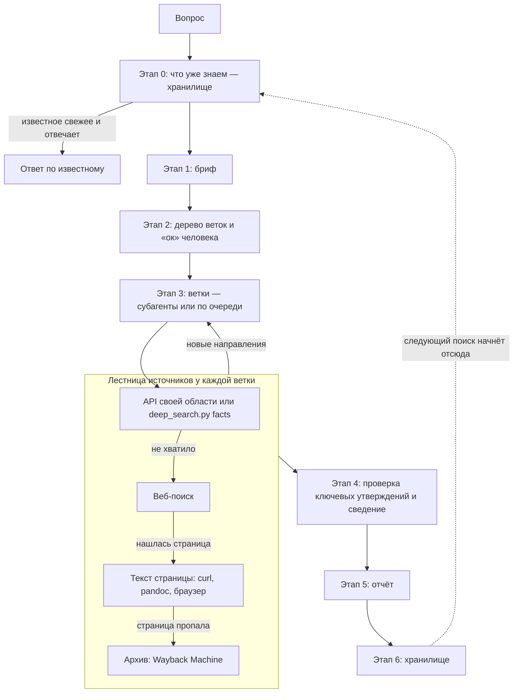
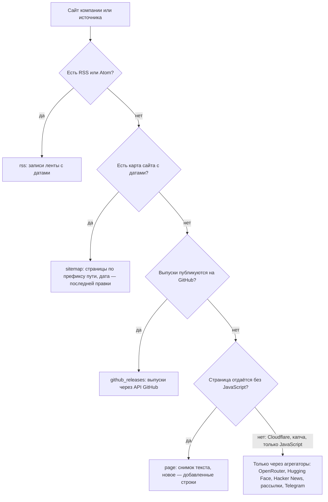

# deep-search: как устроен и как им пользоваться

Для кого: для человека, который пользуется скиллом или хочет понять, как он устроен. Читать можно
подряд: документ идёт от общего к частному. Каждый раздел начинается с того, зачем он нужен.

Статус: описывает скилл по [спецификации](specs/2026-10-05-deep-search-design.md) от 2026-10-05;
мониторинг новинок, команда `facts` и пресет `ai` — по [спецификации](specs/2026-10-09-watch-design.md)
от 2026-10-09. Пока скилл собирается по [плану](plans/2026-10-05-deep-search-plan.md), это описание
замысла.
Примеры помечены словом «пример»; после обкатки их заменят настоящие прогоны. Если код и этот
документ разойдутся, документ правится в том же тикете, что и код.

## Оглавление

1. Зачем этот скилл
2. Как это выглядит со стороны
3. Общая схема: этапы 0–6
4. Подготовка: бриф
5. Поиск: ветки, источники, проверка
6. Хранилище: найденное не теряется и не превращается в свалку
7. Экономия контекста
8. Устройство репозитория: что где и зачем
9. Скрипт `deep_search.py`
10. Как пользоваться
11. Пресеты
12. Чего скилл не делает
13. Словарь

## 1. Зачем этот скилл

*Раздел объясняет, какую проблему решает скилл. Без этого остальное выглядит лишней сложностью.*

**Что такое скилл.** Это набор инструкций для ИИ-агента: агент подгружает их, когда задача им
подходит. deep-search — инструкции о том, как искать информацию качественно. Сам по себе скилл ничего
не ищет: он учит агента порядку работы, а агент пользуется своими инструментами — веб-поиском,
чтением страниц, командной строкой, помощниками-субагентами.

**Что идёт не так, когда агента просто просят «найди».** Исследования агентного поиска
(отчёт [02](../research/2026-10-05-search-landscape/02-research-studies.md)) показывают типичные
провалы:

- агент делает пару запросов и останавливается раньше времени — полноты нет;
- верит сниппету поисковой выдачи или пересказу страницы, а не самой странице. Даже у сильных
  систем источник подтверждает утверждение только в 39–77 % случаев, а 3–13 % ссылок выдуманы;
- не отличает рекламу вендора от документации и пять перепечаток одного пресс-релиза принимает за
  пять подтверждений;
- не помнит, что искали в прошлый раз, и каждый раз начинает с нуля;
- в большом поиске забивает свою рабочую память страницами и начинает ошибаться: чем больше
  действий в одном контексте, тем хуже точность цитат (−42 % при росте с 2 до 150 вызовов).

**Что делает deep-search.** Три части, и каждая закрывает свою группу провалов:

1. **Подготовка** — до поиска фиксируется бриф: что ищем, зачем, что считается ответом, в каких
   границах и с каким бюджетом. Агент не гадает, чего от него хотят.
2. **Поиск** — задача раскладывается на ветки, ветки работают параллельно, каждый источник и
   утверждение получают оценку надёжности, ключевые утверждения проверяет отдельный агент, а
   остановка подчиняется правилам, а не усталости.
3. **Сохранение** — найденное ложится в хранилище, которое читают и человек, и агент. Следующий
   поиск начинает с того, что уже известно.

**Откуда взялся.** Основа — собственная практика поиска технологий: задание на поиск, два прохода по
источникам, журнал, шкала надёжности, остановка по насыщению. Эти правила обобщены на любые темы и
дополнены по итогам исследования: отчёты в папке
[research/2026-10-05-search-landscape/](../research/2026-10-05-search-landscape/README.md). Что
откуда взято, а что придумано здесь, — в [comparison.md](comparison.md).

## 2. Как это выглядит со стороны

*Раздел показывает работу скилла глазами пользователя, до любых подробностей: что вы просите, что
видите, что от вас нужно.*

### 2.1. Быстрый вопрос — уровень S (пример)

Вы спрашиваете: «Под какой лицензией сейчас Redis и с какой версии?»

1. Агент пишет мини-бриф в три строки: вопрос, что будет ответом (лицензия, версия, дата), бюджет —
   до 15 действий.
2. Делает несколько запросов, открывает первоисточники — файл лицензии и заметки к выпуску.
3. Отвечает: «Redis 8 доступен и под AGPLv3; в 03.2024 проект перешёл на SSPL, AGPLv3 добавлен в
   05.2025» — со ссылками, датой проверки и кодом оценки `A1` (первоисточник, подтверждено).

Ничего подтверждать не нужно: на уровне S агент сразу ищет. Сохранять ли ответ в хранилище, решаете
вы (`store: none` — не сохранять).

### 2.2. Серьёзный поиск — уровни M и L (пример)

Вы просите: «Нужно хранить журналы работы сервисов и искать по ним в контуре без интернета. Чем?»

1. **Что уже знаем.** Агент смотрит в хранилище: искали ли похожее, что тогда отвергли и почему.
2. **Бриф.** Агент заполняет всё, что может, и одним списком спрашивает недостающее. Например: какое
   решение будет принято по результату; без чего вариант точно не подходит; что используется сейчас;
   сколько усилий допустимо.
3. **План.** Агент показывает бриф и дерево веток. Например: B1 — какими классами решений это
   вообще решают; B2 и B3 — реализации двух самых подходящих классов; B4 — неудачный опыт и уход с
   этих решений. Ждёт вашего «ок».
4. **Ветки.** Работают параллельно. Каждая пишет свои находки в файлы и возвращает ведущему агенту
   короткую выжимку.
5. **Проверка.** Отдельный агент с «чистой головой» проверяет ключевые утверждения по одному.
6. **Отчёт.** Ответ; кандидаты со ссылками и оценками; что отсеяно и почему; что не успели
   просмотреть; открытые вопросы.
7. **Сохранение.** Карточка темы, утверждения с цитатами, источники — в хранилище.

От вас нужно: ответить на вопросы, подтвердить бриф и план, прочитать отчёт. Если по ходу появится
развилка (например, оказалось, что задачу закрывает уже используемый инструмент), агент спросит.

## 3. Общая схема: этапы 0–6

*Раздел даёт карту всего процесса: на неё опираются все следующие разделы.*

```text
0. Что уже знаем → 1. Бриф → 2. План дерева → «ок» человека → 3. Ветки ─┐
                                                       ↑                 │ раунды, пока
                                                       └── новые ветки ──┘ появляется новое
→ 4. Проверка и сведение → 5. Отчёт → 6. Сохранение
```

Почему именно такой порядок:

- **Хранилище — до брифа.** Чтобы не искать заново то, что известно, и не предлагать то, что уже
  отвергли.
- **Бриф — до поиска.** Требования, выданные по частям в ходе работы, ухудшают результат в среднем на
  39 % (отчёт [02](../research/2026-10-05-search-landscape/02-research-studies.md)).
- **План и «ок» — до веток.** Ветки — самая дорогая часть. Она начинается только после вашего
  согласия.
- **Проверка — отдельно от поиска.** Тот, кто нашёл, плохо проверяет сам себя. Свежий взгляд
  ловит ошибки.
- **Отчёт — до сохранения.** В хранилище попадает только проверенное и сведённое.
- **Сохранение — в конце.** Следующий поиск начнёт отсюда.

Уровень S проходит те же этапы, но коротко: этап 2 без веток, без подтверждения, сохранение — по
желанию.

**Как устроен поиск** — та же схема подробнее: откуда ветка берёт сведения. Каждая ветка идёт по
лестнице источников своей области сверху вниз и спускается, только если ступень выше не дала
ответа (раздел 5.5). На GitHub схема показывается рисунком, в редакторе читается как текст.



## 4. Подготовка: бриф

*Раздел объясняет первую часть скилла: как фиксируется, что именно мы ищем.*

### 4.1. Зачем бриф

Бриф — это техническое задание на поиск. Без брифа агент сам додумывает, что вам нужно, и
додумывает по-своему. С брифом есть точка отсчёта: по нему
строится план, на него оглядываются в ходе поиска, по нему проверяется итог. Так же работают
профессии, где поиск — ремесло: систематические обзоры в науке, разведка, библиотечное дело (отчёт
[08](../research/2026-10-05-search-landscape/08-systematic-methods.md)).

### 4.2. Как бриф появляется

1. Агент заполняет всё, что может, сам: из вашей просьбы и из хранилища.
2. Недостающее спрашивает **одним списком**, а не по одному вопросу.
3. Пересказывает бриф одним абзацем — проверить, правильно ли понял.
4. Начиная с уровня M ждёт «ок».
5. Если по ходу что-то меняется, это записывается в раздел «Поправки»: что, когда и почему. В
   полях остаётся новое значение, история — только в «Поправках».

На уровне S бриф — мини-бриф из трёх строк, без веток и без «ок». С уровня M агент показывает бриф
вместе с планом дерева, уровнем и бюджетом и тем, куда сохранит итог (контрольная точка 0). Если
ответить некому, агент записывает допущения в `assumptions` и «Поправки» и продолжает.

Бриф — файл `brief.md` в папке поиска. Сверху — поля (frontmatter YAML), ниже — «Пересказ» и
«Поправки». Имена полей английские, значения — на любом языке.

### 4.3. Поля по группам

Полей около сорока. Обязательны не все: что именно обязательно, зависит от уровня и типа вопроса.
Ниже — зачем каждая группа и что в ней главное.

**Зачем ищем** — чтобы агент понимал цель, а не только слова запроса.

| Поле | Простыми словами | Зачем |
|---|---|---|
| `id`, `request_ref` | имя поиска и ссылка на исходную просьбу | чтобы найти бриф и понять, откуда он |
| `question` | главный вопрос одной фразой | точка отсчёта; формулируется через задачу: «хранить журналы и искать по ним», а не «нужен аналог Elasticsearch» — иначе поиск сразу сужается до известного |
| `decision_context` | какое решение примут по результату, кто и когда | задаёт глубину и форму ответа |
| `question_type` | тип вопроса — 7 вариантов (4.4) | от него зависит форма поиска |
| `mode` | новый поиск или обновление прежней темы | обновление ищет только новое |
| `stakes` | цена ошибки: низкая, обычная, высокая | чем выше, тем строже подтверждение |

**Что считается ответом** — чтобы агент знал, когда остановиться и что выдать.

| Поле | Простыми словами | Зачем |
|---|---|---|
| `done_criteria` | 3–8 пунктов: каким должен быть ответ; на уровне S — одна строка | по ним проверяется итог |
| `coverage_goal` | первый годный ответ, представительная выборка или всё, что есть | от этого зависят правила остановки |
| `output_format` | в какой форме нужен ответ: таблица, список, короткий вывод | форма отчёта |
| `if_not_found` | что делать, если данных нет | по умолчанию — честно «не найдено» и что пробовали, без догадок |

**Предмет и критерии** — что подходит, а что нет.

| Поле | Простыми словами | Зачем |
|---|---|---|
| `concept`, `subject` | что ищем и для каких условий | область поиска |
| `inclusion_criteria` | без чего вариант не подходит | фильтр: «обязательные функции» |
| `exclusion_criteria` | что сразу исключает | «жёсткие ограничения»: работа без интернета, лицензия и т. п. |
| `baseline` | что есть сейчас или «ничего не менять» | с чем сравнивать |
| `comparison_criteria` | по каким признакам «лучше» | для сравнений |
| `data_items` | что выяснить по каждому найденному | лицензия, поддержка, версия… |
| `current_assets` | что у вас уже есть | вдруг задачу закрывает имеющееся |
| `known_items` | варианты, которые вы уже знаете | точки старта и тест полноты: хороший поиск их находит |
| `hypotheses` | конкурирующие ответы | для проверки «правда ли, что…» |
| `assumptions` | допущения | незаданное помечается «без ограничения», а не выдумывается |
| `type_data` | данные своего типа вопроса | что заменяем и к какому сроку; текст требования |

**План поиска** — где и как искать.

| Поле | Простыми словами | Зачем |
|---|---|---|
| `sub_questions` | подвопросы — будущие ветки | у каждого статус покрытия: не закрыт, частично, закрыт (0, 0,5, 1) |
| `perspectives` | 3–6 точек зрения (эксплуатация, безопасность, критик…) | запросы получаются разнообразнее |
| `keywords` | слова и синонимы на русском и английском | без них поиск находит только очевидное |
| `sources_plan` | обязательные, желательные, запрещённые источники | откуда брать и чему не верить |
| `limits`, `as_of_date` | языки, период, география; на какую дату нужны сведения | границы |
| `prior_work`, `exclusions` | что уже искали и что отвергли | заполняется из хранилища |

**Бюджет и остановка** — сколько усилий потратить: `budget_tier` (уровень S–XL), `budget`
(действия, время, срок), `stop_rule` (когда хватит), `min_confirmation` (сколько подтверждений
нужно ключевым утверждениям). Значения по умолчанию берутся от уровня и от `stakes`.

**Хранение и ограничения:**

- `store` — куда сохранить: в общую библиотеку, в проект или никуда (последнее — только для S);
- `store_topic` — тема в хранилище;
- `report_path` — куда положить копию отчёта;
- `disclosure_constraints` — что нельзя отправлять во внешние сервисы;
- `preset` — предметная область, например `technology`.

### 4.4. Семь типов вопроса

Тип вопроса — главное поле брифа: от него зависит, как будет устроен поиск (раздел 5.2).

| Тип | Когда | Пример |
|---|---|---|
| `fact` | один проверяемый факт | «Под какой лицензией Redis?» |
| `validation` | правда ли утверждение; какая из гипотез верна | «Правда ли, что X работает без интернета?» |
| `comparison` | сравнить известные варианты | «A или B для нашей задачи?» |
| `options` | найти варианты решения задачи | «Чем хранить журналы и искать по ним?» |
| `exhaustive_list` | полный перечень по критериям | «Все открытые решения класса X с установкой у себя» |
| `replacement` | замена известного решения | «У X кончается поддержка — на что переходить?» |
| `compliance` | что закрывает требования документа | «Что закрывает пункты требования такого-то?» |

### 4.5. Уровни S, M, L, XL

Уровень задаёт, сколько усилий потратить и сколько вашего участия нужно.

| Уровень | Когда | Ветки | Действий всего | Ваше участие |
|---|---|---|---|---|
| S | быстрый вопрос, один факт | 0–1 | до 15 | никакого: агент сразу ищет |
| M | сравнение, проверка, замена, требования | 2–4 | 30–60 | подтвердить бриф и план |
| L | поиск вариантов, перечень | 3–5, 1–2 круга | 60–120 | то же и промежуточная сверка |
| XL | большой исчерпывающий перечень | 5–10, не больше 20 | 100–200 | то же |

Уровень по умолчанию агент предлагает по типу вопроса: `fact` — S; проверка, сравнение, замена,
требования — M; варианты и перечень — L; исчерпывающий перечень больше 50 объектов — XL. Вы можете
изменить уровень. Числа стартовые, их уточнят первые реальные поиски.

### 4.6. Вопросы, которые может задать агент

Агент задаёт только те, ответов на которые нет в просьбе и в хранилище:

1. Какое решение будет принято по результату и кем?
2. Что для вас «ответ»: список, одна рекомендация, сравнение, да/нет? Сколько вариантов?
3. Где уже искали, что нашли и отвергли, почему?
4. Что используется сейчас и чем не устраивает?
5. Без чего вариант не подходит, а что его сразу исключает?
6. Какие подходящие примеры вы уже знаете?
7. Какие слова должны встретиться в результатах, как это называют специалисты, на каких языках?
8. Насколько свежими должны быть сведения, каким источникам не доверять?
9. К какому сроку нужен результат и сколько усилий допустимо?
10. Что нельзя упоминать в запросах к внешним сервисам?

Отвечать можно коротко. «Не знаю» — тоже ответ: агент запишет допущение и продолжит.

## 5. Поиск: ветки, источники, проверка

*Раздел объясняет вторую часть скилла: как идёт сам поиск и почему ему можно доверять.*

### 5.1. Ветки: что это и зачем

**Ветка** — часть поиска с одной целью. Её выполняет отдельный агент-помощник (субагент) со своей
рабочей памятью. Агент, который ведёт весь поиск, называется **ведущим**: он пишет бриф, строит
план, раздаёт ветки, сводит результаты.

Зачем ветки:

- **быстрее** — ветки идут параллельно;
- **чище** — каждая ветка работает в своей рабочей памяти, ведущий не тонет в сотнях страниц и
  получает только короткие выжимки;
- **полнее** — разные ветки смотрят на задачу с разных сторон.

Когда веток нет: простой факт; цепочка, где следующий шаг зависит от предыдущего; задача, в которой
важно качество источников, а не охват. Ветвление стоит дорого — многоагентная работа расходует
примерно в 15 раз больше токенов, чем обычный чат, а на цепочках оно вредит (отчёт
[07](../research/2026-10-05-search-landscape/07-branching-budget.md)).

Если агент не умеет запускать помощников (например, Codex или модель, развёрнутая в закрытом
контуре), ветки идут по очереди — с теми же файлами и правилами, просто дольше.

### 5.2. Какое получится дерево

Форма дерева зависит от типа вопроса:

| Тип | Как раскладывается задача |
|---|---|
| `fact` | без веток; трудный факт — 2–3 независимые попытки и сверка |
| `validation` | ветка на каждую гипотезу; упор на качество источников |
| `comparison` | ветка на каждый вариант и общий список критериев |
| `options` | сначала «какими классами решений это решают», потом реализации каждого класса |
| `exhaustive_list` | перечень делится на части, у всех один способ опознавать дубли; в конце — контрольная проверка |
| `replacement` | лестница от дешёвого перехода к дорогому: поддерживаемая версия → форк или преемник → другие реализации того же интерфейса → отечественные аналоги → решения другого класса |
| `compliance` | каждое незакрытое положение требования — свой поиск; итог — таблица «положение → чем закрывается» |

Три последних типа пришли из поиска технологий — замена, требования, решение проблемы — и обобщены на
любые предметы.

### 5.3. Сколько веток и сколько усилий

Усилия считаются в **вызовах**: вызов — одно обращение наружу (поиск, открытие страницы или PDF,
запрос к API). Сколько их у ветки, видно по её журналу: строка журнала — один вызов.

Число веток задаёт уровень, а форму — тип вопроса (5.2):

| Уровень | Ветки | Вызовов на ветку: пора сворачиваться / стоп | Вызовов всего |
|---|---|---|---|
| S | 0–1 | 3–10 / 15 | до 15 |
| M | 2–4 | 10–15 / 20 | 30–60 |
| L | 3–5, 1–2 круга | 10–15 / 20 | 60–120 |
| XL | 5–10, не больше 20 | до 15 / 20 | 100–200 |

- Одновременно работают не больше 5 веток; на одном уровне дерева — не больше 7, иначе их
  группируют; на весь поиск — не больше 20, иначе план перестраивают.
- Глубина — не больше двух кругов расширения: ветки следующего круга рождаются из находок
  предыдущего, и их вдвое меньше, но не меньше двух. Третий круг — только отдельным решением, если
  новое продолжает прибывать.
- Бюджет делится примерно так: 55–60 % — найти, 25–30 % — проверить по первоисточникам, 15 % —
  свести.
- Ветки, которые приносят меньше среднего, закрываются, их бюджет переходит лидерам.
- На 80 % бюджета новых веток не открывают, а работающие сворачиваются.
- У Claude Code есть предел — 200 веб-поисков на сессию вместе с помощниками. Ведущий считает их в
  плане прогона; ближе к 160 переходит на API и прямую загрузку страниц или продолжает в новой
  сессии. Упереться в предел может только XL.

Числа стартовые: их уточнят первые реальные поиски.

### 5.4. Что делает ветка

Ветка получает задание. В нём: общая цель поиска, её собственная цель, какой нужен ответ, когда
хватит, чем заняты соседние ветки (чтобы не дублировать), откуда начинать, бюджет и куда писать
находки. Задание самодостаточно: помощник не видит вашего разговора с ведущим, поэтому всё нужное
передаётся в задании.

Дальше ветка работает в четыре прохода:

1. **Пробный поиск** — понять, как об этом пишут, и собрать термины.
2. **Охват** — каталоги, обзоры, подборки: найти как можно больше кандидатов.
3. **Проверка по первоисточникам** — каждую находку проверить по самому надёжному источнику.
4. **Расширение по связям** — от найденного к соседнему: альтернативы, на что и с чего переходят,
   форки и преемники, соседи по каталогу. Круги повторяются, пока появляется новое.

Обязательные приёмы — их ветка делает всегда:

- **ищет опровержение** к каждому ключевому выводу: неудачный опыт, разборы отказов, «почему мы
  отказались от X»;
- **проверяет, нет ли решения у вас** — вдруг задачу закрывает уже используемое;
- **сверяется с прежними решениями** — отвергнутое не исследуется заново, но новые сведения о нём
  отмечаются.

Запросы короткие (2–5 слов), на русском и английском. Повтор запроса — признак, что ветка ходит по
кругу: тактику меняют. Пустая выдача — повод переформулировать, а не написать «данных нет».

**Как ветка достаёт текст.** Встроенные инструменты агента ограничены (отчёт
[01](../research/2026-10-05-search-landscape/01-tools-products.md)): веб-поиск Claude Code
возвращает только заголовки и ссылки, а инструмент чтения страниц — пересказ маленькой моделью, а не
сам текст. Поэтому порядок такой:

1. Сначала специализированные источники: документация библиотек (context7), GitHub, каталоги
   пакетов, базы уязвимостей, научные базы — они дают точные данные без «шума». Какие именно и
   почему — 5.5.
2. Обычный веб-поиск — чтобы найти ссылки.
3. Полный текст страницы — через командную строку (curl с конвертером в текст, извлечение текста из
   PDF, безголовый браузер для страниц на JavaScript). Только из полного текста берутся цифры и
   цитаты.
4. Пересказ страницы — только чтобы решить, стоит ли её открывать.
5. Мёртвую ссылку проверяют в веб-архиве: устарела она или выдумана.

Ветка пишет журнал — что искала, где, сколько просмотрела, что нашла — и **улики**: строки вида
«источник, место, цитата, оценка, происхождение». Дата в улике — дата проверки, то есть когда ветка
прочитала страницу; дата публикации источника пишется рядом с происхождением, а если её нет —
«б/д».

Ветка оценивает то, что видит сама: ставит букву надёжности каждой улике, а своим утверждениям —
предварительную оценку и класс свежести (5.6). Окончательную оценку ставит ведущий при сведении:
только он видит все ветки и может понять, что две находки восходят к одному источнику.

Ведущему ветка возвращает короткий ответ: не больше 1,5 тысячи токенов и путь к своим файлам. В
ответе — находки с оценками, что отсеяно и почему, что не нашлось, куда стоит копать дальше и,
если вы назвали известные примеры, сколько из них ветка нашла сама (например, «4 из 5»).

### 5.5. Какие источники и почему

**Как отбирали.** Источник попадает в набор, если отвечает трём требованиям:
- даёт первоисточник или точные данные, а не пересказ;
- работает бесплатно и без ключа;
- не отправляет запрос третьей стороне без нужды. Это важно, когда сама тема поиска непублична: что
  нельзя называть внешним сервисам, задаёт поле брифа `disclosure_constraints`.

Набор собран по обзору инструментов (отчёт
[01](../research/2026-10-05-search-landscape/01-tools-products.md)) и проверен запросами к самим
источникам ([проверка 2026-10-09](../research/2026-10-09-sources-check/README.md)). Набор не
окончательный и пополняется по итогам реальных поисков.

Источники разделены на группы по тому, на какой вопрос они отвечают. Внутри поиска группы работают
по очереди: веб-поиск и каталоги находят кандидатов, специализированные источники дают точные
данные о них, инструменты чтения достают текст для цитаты.

#### Найти, где искать

Эти источники ничего не подтверждают. Они отвечают на вопрос «что вообще существует и где об этом
написано»: дают ссылки и названия, которые потом проверяются по первоисточникам.

| Источник | Для чего |
|---|---|
| WebSearch — веб-поиск агента | найти страницы по запросу. Отдаёт только заголовки и ссылки, не больше 200 вызовов на сессию |
| Каталоги и подборки из пресета: ландшафты технологий, awesome-списки, темы GitHub, AlternativeTo | увидеть всё поле сразу: какие есть решения данного класса и что предлагают вместо известного (раздел 11) |
| Хабр, доклады конференций, разборы опыта | узнать, какие классы решений бывают и как они ведут себя в работе. Опыт эксплуатации — уровень C |
| Wikidata | сверить простой факт — лицензию, дату выпуска, разработчика — с другими источниками. Это вики: указатель, а не подтверждение |

#### Программы: что это и как устроено

Ответ «из первых рук»: что программа умеет, под какой она лицензией, когда вышла версия. Здесь
получаются оценки уровня A.

| Источник | Для чего |
|---|---|
| context7 | документация библиотеки нужной версии: как ею пользоваться, какие есть параметры. Точнее веб-поиска, потому что отдаёт фрагменты именно по версии и теме; цитата берётся со страницы, откуда взят фрагмент |
| GitHub: API и файлы репозитория | лицензия, выпуски, активность, сам код. Первоисточник для большей части открытого ПО. Без токена — 60 запросов в час, с токеном — 5 000 |
| Другие хостинги кода: GitLab, Codeberg и любые на Forgejo или Gitea, Gitee | то же для проектов, которые живут не на GitHub. Без токена запросов немного — хватает на точечные проверки |
| Поиск по чужому коду: GitHub (с токеном), grep.app, Sourcegraph | как библиотекой пользуются на деле и кто её использует — по коду публичных репозиториев |

#### Программы: можно ли на них опираться

Одна и та же программа может быть хорошей, но заброшенной, уязвимой или с кончающейся поддержкой.
Эта группа отвечает на вопрос «не подведёт ли она через год». Все источники — открытые базы с API:
данные точные и одинаковые для всех.

Главное из этой группы и из API хостинга кода собирает одна команда — `deep_search.py facts`
(раздел 9): лицензия, выпуски, последний коммит, уязвимости, сроки поддержки, загрузки, оценка
сопровождения, дистрибутивы — у каждого значения адрес запроса и путь к полю. Ветка начинает с неё,
а к источникам ниже обращается за тем, чего в сводке нет.

| Источник | Для чего |
|---|---|
| endoflife.date | до какого числа поддерживается версия. Сроки сотен продуктов в одном формате |
| OSV | известные уязвимости конкретной версии пакета. Сводит несколько баз; пустой ответ не значит «уязвимостей нет» — базы пополняются с задержкой |
| deps.dev | версии, лицензии и уязвимости пакетов npm, PyPI, Go, Maven, Cargo, NuGet — один API вместо отдельного для каждого реестра |
| ecosyste.ms | сколько скачивают и сколько проектов зависят от пакета — пользуются ли им на деле |
| OpenSSF Scorecard | как сопровождается проект: есть ли ревью кода, регулярные выпуски, защита веток. Готовая проверка вместо ручной |
| Repology | в каких дистрибутивах Linux и репозиториях пакетов есть программа и какой версии — легко ли её поставить |
| Реестры из пресета: российского ПО, сертифицированных средств защиты ФСТЭК | можно ли использовать там, где это требуется по закону |

#### Опыт и обсуждения

Как программа ведёт себя у других: что ломается, на что жалуются, почему от неё отказались. Отсюда
берутся ответы на запрос-опровержение. Это опыт людей, уровень C: не измерение и не первоисточник.

| Источник | Для чего |
|---|---|
| Hacker News | обсуждения разработчиков с рейтингом; опыт обычно в комментариях, а не в самой статье |
| Stack Exchange (Stack Overflow) | конкретные проблемы и их решения. Без ключа — 300 запросов в сутки |

#### Наука

Статьи и их судьба: кто что опубликовал, на что ссылаются, не отозвана ли работа.

| Источник | Для чего |
|---|---|
| OpenAlex | найти работы по теме и отсортировать по цитированиям: открытый каталог почти всей научной литературы |
| arXiv | препринты: работы по ИИ и смежным областям появляются там раньше всего. Препринт ещё не прошёл рецензию, поэтому без открытых данных — не выше C |
| Crossref | официальные сведения о статье по DOI и уведомления об отзыве: отозванную статью скилл не использует |
| Unpaywall | найти легальную открытую копию статьи по DOI, чтобы цитировать текст, а не аннотацию. Нужен настоящий адрес почты того, кто запускает |
| Europe PMC | биомедицина: статьи и признак открытого доступа |

#### Нормативные акты

| Источник | Для чего |
|---|---|
| pravo.gov.ru — официальное опубликование | найти акт и дату его официальной публикации — это первоисточник. Пресета для нормативки пока нет, но источник уже доступен |

#### Инструменты чтения

Это не источники, а способ достать текст. Нужны, потому что встроенные средства агента дают либо
только ссылки, либо пересказ, а число и цитата берутся только из настоящего текста.

| Инструмент | Для чего |
|---|---|
| curl + pandoc, pdftotext, безголовый Chromium | полный текст обычной страницы, PDF, страницы на JavaScript. Работает на своей машине |
| Jina Reader | запасной путь для сложных страниц, без ключа. Адрес страницы уходит стороннему сервису, поэтому — только если бриф это разрешает |
| WebFetch | только решить, стоит ли открывать страницу: отвечает малая модель, сам текст она не отдаёт |
| Wayback Machine | открыть пропавшую страницу из архива и понять, устарела ссылка или выдумана |

#### Новинки ИИ

Чтобы быть в курсе отрасли, нужны другие источники: не «что известно о X», а «что появилось за
последние дни». Их читает команда `deep_search.py watch` (разделы 9 и 10.5): скачивает ленты,
отбрасывает то, что видела в прошлые разы, склеивает одну новость из разных лент в одну запись и
грубо отбирает по словам интересов. Всё это делает код, без модели: агент тратит токены только на
новое, когда пишет дайджест. Готовый набор — 68 лент в скилле (`presets/ai-feeds.json`), проверены
2026-10-09: отдаются без ключа, без входа и без браузера. Свои ленты и отключения — в библиотеке.

**Как `watch` читает сайт.** У каждого сайта берётся самый надёжный машинный канал, который у
него есть. Способ чтения называется типом ленты; новая лента известного типа — одна строка в
наборе, новый тип — только кодом.



| Тип | Что читает |
|---|---|
| `rss` | RSS и Atom: блоги, рассылки, блоги компаний на Хабре, Reddit. Лента, которая вместо XML отдаёт HTML-страницу, считается не ответившей |
| `sitemap` | карта сайта: страницы нужных разделов по началу пути. Дата в карте — последней правки, поэтому старая страница после правки может всплыть как новая |
| `github_releases` | выпуски репозитория через API GitHub. Без токена — 60 запросов в час, с `GITHUB_TOKEN` — 5 000 |
| `hf_trending`, `hf_papers` | модели в тренде Hugging Face, созданные за последние дни; статьи недели, за которые проголосовали от 100 человек |
| `openrouter` | каталог моделей OpenRouter: новые по дате появления в каталоге — она не совпадает с датой выхода модели |
| `hn` | Hacker News по запросам о моделях и агентах, обсуждения от 100 очков |
| `telegram` | публичный канал через веб-версию `t.me/s/<канал>`, без входа |
| `page` | страница без ленты, обычно журнал изменений документации: новое — строки, которых не было в прошлый раз. Даты у такой записи нет — ставится время опроса, первый запуск только запоминает страницу |

**Первоисточники: компании.** По ним новость подтверждается — для фактов о себе это уровень A.

- Своя лента или карта сайта с датами: Anthropic, OpenAI, Google (DeepMind, блог об ИИ, блог для
  разработчиков), Mistral, Cohere, Z.ai, Microsoft AI и Azure, AWS и Amazon Science, NVIDIA,
  Hugging Face, Meta (инженерный блог). Яндекс и Сбер — через свои блоги на Хабре.
- Журналы изменений документации — снимком страницы: API Anthropic, OpenAI (и список моделей),
  Gemini API, Mistral, xAI, DeepSeek, Kimi, MiniMax, GigaChat; новости Яндекса. Так видны и
  компании, у которых своей ленты нет: сайт xAI закрыт Cloudflare, у DeepSeek и MiniMax ленты нет.
- Выпуски на GitHub: Claude Code, Codex, Gemini CLI, Qwen Code, Kimi CLI, SDK xAI, модели Llama,
  GigaChat, transformers (по нему видна поддержка новых архитектур моделей).
- Блог Qwen работает только на JavaScript, блог Meta AI закрыт для роботов: эти новости видны по
  выпускам на GitHub, по OpenRouter и Hugging Face.

**Сеть: агрегаторы и рассылки по всей отрасли.** Через них видно, *что* вышло, у кого бы ни вышло.
Для фактов — уровень D: новость подтверждается по первоисточнику.

| Источник | Для чего |
|---|---|
| OpenRouter, каталог моделей | почти каждая модель с API появляется здесь вскоре после выхода: дата появления, цена, длина контекста |
| Hugging Face: модели в тренде, статьи недели | новые открытые модели, которые люди действительно скачивают, и статьи, за которые голосуют. Сортировка просто по дате бесполезна — там в основном мусор |
| Hacker News | что обсуждают разработчики; рейтинг обсуждения — сигнал, что новость важна, а не только громкая |
| Reddit r/LocalLLaMA, лучшее за неделю | открытые модели глазами тех, кто запускает их у себя. Не чаще запроса в минуту |
| Рассылки обозревателей: Simon Willison, Import AI, Interconnects, Latent Space и её ежедневный AINews, The Batch | отбор и разбор от людей, которые читают отрасль целиком, включая X и Discord |

Ленты arXiv по разделам не читаются: в них сотни статей в день без отбора, а заметные статьи
приходят через статьи недели Hugging Face. Рейтинг LMArena и каталоги Epoch AI — не новости, а
данные для сравнения моделей: они в пресете `ai` (раздел 11).

**Чего не достать самим.** Многое лаборатории первыми публикуют в X (Twitter) и Discord, а туда без
входа и платного API не попасть. Здесь нужен внешний источник: авторские каналы и рассылки, которые
эти места читают и ставят ссылки. Новостные каналы, которые пересказывают открытые ленты, не нужны:
эти ленты `watch` читает сам. В наборе 12 авторских Telegram-каналов, все «на пробу»: `watch`
считает, сколько новостей канал дал первым и сколько — только он, и через 8 запусков без своего
предлагает его отключить. Отрасль в основном англоязычная, поэтому русскоязычные источники нужны
прежде всего для новостей Яндекса и Сбера.

**Когда лента ломается.** Сайты меняют адреса и разметку. Лента, которая не ответила или прислала
не то, не ломает запуск — она попадает в строку «не ответили»; после трёх провалов подряд `watch`
помечает её «проверить или отключить». Решает человек.

#### Что покрыто, а что нет

| Область | Чем покрыта | Чего нет |
|---|---|---|
| Открытое ПО на GitHub | хорошо: GitHub, документация, все источники группы «можно ли опираться» | — |
| Открытое ПО вне GitHub | Codeberg и другие хостинги на Forgejo и Gitea, GitLab, Gitee — без токена немного запросов | GitFlic — API только с токеном |
| В каких дистрибутивах есть пакет | Repology | — |
| Коммерческое и закрытое ПО | сайт вендора (A — о фактах о себе, E — об оценках себя), обзоры и опыт через веб-поиск | независимых измерений, кроме найденных поиском |
| Документация библиотек | context7 | — |
| Уязвимости, сроки поддержки, зрелость пакетов | OSV, endoflife.date, deps.dev, ecosyste.ms, Scorecard | уязвимостей, которых ещё нет в базах |
| Код в чужих репозиториях: кто и как использует | поиск по коду GitHub (с токеном), grep.app, Sourcegraph | без токена GitHub; у Sourcegraph анонимный доступ не задокументирован |
| Опыт эксплуатации, обсуждения, «почему отказались» | веб-поиск, Hacker News, Stack Exchange (300 запросов в сутки без ключа) | Reddit — только медленная лента, раз в минуту |
| Справочные факты: лицензия, дата выпуска, разработчик | Wikidata | — |
| Научные статьи | OpenAlex, arXiv, Crossref; Unpaywall — открытая копия статьи по DOI; Europe PMC — биомедицина | текста платных статей без открытой копии |
| Российская наука | только веб-поиск | КиберЛенинка — поиск закрыт для роботов, открыта только выгрузка по датам |
| Российское ПО и требования к нему | реестры из пресета, Хабр, веб-поиск | — |
| Новинки ИИ: модели, инструменты для агентов, изменения у поставщиков, статьи, программы для ИИ | мониторинг: `watch` по 68 лентам — компании, выпуски на GitHub, агрегаторы, рассылки, Telegram; дайджест по сценарию «что нового» (10.5) | X и Discord — только пересказ в каналах и рассылках; сайты только на JavaScript или за Cloudflare — только через агрегаторы; расписания нет — запуск вручную |
| Законы и нормативные документы | pravo.gov.ru — официальное опубликование; веб-поиск | пресета нет — вне первой версии |
| Рынок, компании, финансы | только веб-поиск; пресета нет | вне первой версии |
| Закрытые площадки: X, Discord, LinkedIn, закрытые чаты | только пересказ в авторских каналах и рассылках | прямого доступа нет |
| Видео и подкасты: доклады, интервью | только описание и ссылка через веб-поиск | расшифровок |
| Пропавшие страницы | Wayback Machine | Wayback отвечает нестабильно; archive.today недоступен; сохранить страницу в архив самим — только с ключом |
| Сайты с защитой от роботов, платный доступ | — | недоступны |
| Внутренние данные организации | — | вне первой версии |

#### Что не взяли

| Что | Почему | Когда пересмотреть |
|---|---|---|
| Поисковые API для агентов: Exa, Tavily, Brave Search, Parallel, Linkup, Kagi | нужен ключ, чаще платный; запросы уходят третьей стороне | появится ключ, и бриф разрешит отдавать запросы наружу |
| Firecrawl | то же; текст страницы и так извлекается на своей машине | так же |
| SearXNG — свой метапоиск | его надо держать в контейнере и следить, чтобы поисковики его не блокировали; пока хватает встроенного поиска, это лишняя работа | упрёмся в 200 вызовов WebSearch на сессию, у агента нет встроенного поиска или WebSearch не находит известные примеры |
| MCP-серверы для страниц и GitHub (fetch, Playwright, GitHub MCP) | командная строка даёт то же без установки сервера и тратит меньше токенов; авторы Playwright MCP сами советуют CLI | у агента не будет командной строки |
| Semantic Scholar | без ключа не отвечает: анонимный доступ общий на всех и исчерпан; метаданные и цитирования даёт OpenAlex | понадобятся краткие пересказы статей или контексты цитирований — бесплатный ключ |
| Artificial Analysis | данные только с ключом и учётной записью | появится ключ |
| Papers with Code | закрыт, адрес ведёт на Hugging Face | — |
| Публичный RSSHub | закрыт защитой от роботов | — |
| Libraries.io | по документации нужен ключ; то же дают deps.dev и ecosyste.ms | — |
| Save Page Now — сохранение страницы в веб-архив | нужен ключ archive.org | понадобится фиксировать ключевые страницы в архиве |
| Новостные каналы и боты, которые пересказывают ленты | дублируют ленты, которые `watch` читает сам | — |
| Ленты arXiv по разделам | сотни статей в день без отбора; заметные статьи приходят через статьи недели Hugging Face | понадобится следить за узкой темой — лента раздела с фильтром по словам |
| AWS What's New, страницы статуса, выпуски SDK поставщиков | много записей не об ИИ или не о новинках: около 100 записей за 10 дней по всему AWS, сбои сервисов, мелкие версии | понадобится следить за доступностью или за конкретным SDK |
| Реестр MCP, GitHub Trending | реестр — больше 100 публикаций за два дня без ранжирования; в GitHub Trending около 11 строк, нет даты и API | — |
| Знания модели как источник | заинтересованность и происхождение не проверить — уровень E | — (годятся для гипотез и слов для запросов) |

Команды всех API — `references/apis.md`. Что делает агент, когда отложенное становится доступно, —
`references/environment.md`, раздел «Отложенное».

### 5.6. Как оцениваются источники и утверждения

Это ядро качества. Оценка ставится не источнику вообще, а паре «источник × утверждение»: одна и та же
документация вендора — надёжный источник для «в версии 18 есть опция X» и ненадёжный для «мы самая
быстрая база данных».

Код оценки — буква и цифра, например `B2`.

**Буква A–F — насколько этому источнику можно верить в этом вопросе.** Агент отвечает на четыре
вопроса по порядку: известно ли, кто стоит за источником → заинтересован ли он в утверждении →
есть ли у него доступ к факту → есть ли у него проверяемый метод.

| Буква | Что значит | Примеры |
|---|---|---|
| A | сам первоисточник факта | исходный код, документация нужной версии, файл лицензии, официальная публикация закона, реестр |
| B | независимый наблюдатель с методом | воспроизводимый бенчмарк с данными, рецензируемая статья, официальная статистика |
| C | свидетель из первых рук, но без метода | отчёт об эксплуатации, разбор аварии, доклад |
| D | пересказ, обзор, мнение | технологические радары, каталоги, энциклопедии, форумы |
| E | заинтересованная сторона | реклама и пресс-релизы, партнёрские обзоры, выводы ИИ |
| F | неизвестно, кто стоит за источником | страница без владельца |

**Цифра 1–6 — насколько утверждение подтверждено.**

| Цифра | Значит | Когда ставится |
|---|---|---|
| 1 | подтверждено | первоисточник A нужной версии или два независимых надёжных источника |
| 2 | вероятно | один надёжный источник или два независимых свидетеля |
| 3 | возможно | один свидетель, пересказы, есть неснятое противоречие (тогда к коду добавляется `!`) |
| 4 | сомнительно | только заинтересованные источники |
| 5 | опровергнуто | противоречит первоисточнику |
| 6 | нельзя судить | страница не открыта, источник не найден или сведения устарели |

У цифры есть **потолки**: сколько бы ни было рекламы, выше 4 утверждение не поднимется; сколько бы
ни было пересказов — выше 3. Это защищает от главной ловушки: повторение — не подтверждение.

**Отсутствие — не отрицание.** «X не поддерживает Y» получает «1», только если первоисточник прямо
пишет «не поддерживается». Иначе утверждение записывается как «не найдено в <таких-то источниках на
такую-то дату>» и выше «2» не поднимается.

**Независимость** считается по происхождению. Пять статей, пересказывающих один пресс-релиз, — один
источник, а не пять. Поэтому у каждой улики записано, откуда сведение пришло изначально, и
подтверждения считает ведущий по всем веткам сразу: отдельная ветка этого не видит.

**Свежесть.** Сведения стареют с разной скоростью. Номер последней версии устаревает за недели,
лицензия — за месяцы, архитектурный принцип — за годы. Поэтому у сведений есть класс изменчивости и
срок перепроверки: быстрые (V3) — 7–30 дней, средние (V2) — 90 дней, медленные (V1) — 12 месяцев,
неизменные (V0) — бессрочно. Просроченное получает «6» и до перепроверки считается гипотезой.

**Красные флаги** понижают оценку: у страницы нет владельца; конфликт интересов; ферма контента;
партнёрские обзоры; бенчмарк без конфигурации и данных; накрученные звёзды и отзывы; хищнический
журнал; отозванная статья (её не используют вовсе).

Пример: «Redis 8 доступен под AGPLv3» по файлу лицензии — `A1`. «Команды до 87 % быстрее» по
анонсу Redis — `E4`. Такое утверждение не выбрасывают, а хранят с пометкой «по заявлению Redis, …»:
то, что Redis это заявил, подтверждено (`A1`), а само содержание остаётся сомнительным (`E4`).

Пятиуровневая шкала типов источников ложится на буквы один к одному: первоисточники — A, бенчмарки — B,
опыт эксплуатации — C, обзоры экспертных сообществ — D (потолок 3), материалы вендора и выводы ИИ —
E (потолок 4).

### 5.7. Когда ветка и поиск останавливаются

Ветка останавливается, если: цель достигнута; три источника или два поиска подряд не дали нового
(**насыщение**); две переформулировки ничего не дали (**тупик** — ответ «не найдено» со списком
испробованного); кончился бюджет; запросы ушли от темы. Ветка останавливается сама и отвечает, а
закрывает её ведущий. Он же может снять ветку, не дожидаясь ответа, — например, если она ушла от
темы или бюджет подошёл к 80 % (в плане у неё тогда статус `closed`), — и может открыть ветку снова.

Весь поиск заканчивается одним из двух способов:

- **Всё сделано.** Просмотрены обязательные источники; у каждого подвопроса есть статус; два круга
  подряд ничего нового. Для полных перечней, замены и требований — ещё контрольная выборка «с другой
  стороны»: 3–5 запросов на другом языке или в другой группе источников. Если и она ничего не дала,
  поиск закончен.
- **Кончился бюджет.** Тогда отчёт честно называет себя «неисчерпывающим» и перечисляет, что не
  просмотрено и какие направления остались открытыми. С них можно продолжить.

### 5.8. Проверка и сведение

**Проверка.** Ключевые утверждения — те, на которых держится ответ, — проверяет отдельный агент,
который не видел черновика. Один проверяющий берёт до 10 утверждений и проверяет их строго по
одному. По каждому он получает открытый вопрос («под какой лицензией выпущен X, по этой странице?»,
а не «правда ли, что X под такой-то лицензией?») и адрес страницы с местом, но не цитату, которую
нашла ветка: так он читает страницу сам, а не сверяет готовый ответ. Сначала он отвечает на вопрос
по странице и только потом сравнивает ответ с утверждением.

Вердикт — «да», «частично» или «нет», с цитатой; всё пишется в протокол `verify.md`. У «нет»
названа причина, и от неё зависит, что дальше:

- «не говорит» — страница этого не подтверждает: улику снимают, а если других нет, утверждение
  уходит в отсеянное;
- «противоречит» — оценку пересчитывают, противоречие разбирают при сведении;
- «не открыта» — оценка «6», нельзя судить: не проверено — не значит опровергнуто.

Так устроено потому, что на вопрос «да/нет» модель склонна соглашаться, а свежий взгляд находит
больше ошибок (отчёт [02](../research/2026-10-05-search-landscape/02-research-studies.md)).
Остальные утверждения проверяются выборочно. В конце проверяется, что все ссылки открываются.

**Сведение.** Итог пишет один автор — ведущий:

- находки сразу ложатся в реестр — таблицу в разделе 4 отчёта, чтобы не потеряться при сжатии
  памяти агента. Внутри прогона у находки номер `F1`, `F2`…; постоянный номер утверждения она
  получает только при сохранении в хранилище;
- окончательная оценка ставится здесь: по всем веткам сразу и по независимому происхождению;
- одинаковые находки из разных веток схлопываются, их подтверждения складываются;
- противоречия не усредняются: в отчёте видны обе стороны и чем всё решилось;
- список не добивается сомнительными позициями ради количества;
- факты, допущения и суждения разделены, а уверенность названа словами: «вероятно»,
  «маловероятно».

### 5.9. План, журнал и отчёт

**План прогона** `plan.md` — короткое состояние поиска, не больше 4 000 символов. Сверху — уровень,
бюджет, сколько потрачено, сколько веб-поисков сделано, какой идёт круг, пройдены ли контрольные
точки. Ниже — таблица веток (цель, статус, бюджет по плану и по факту, что принесла), «Решения» —
что и почему поменяли в плане, и «Следующий шаг» — одно действие, которое можно выполнить, ничего
не помня о прошлом. Ведущий обновляет план после каждого события; по нему же продолжает после
сжатия памяти или в новой сессии.

**Журнал** — запись каждого действия: когда, где, какой запрос, сколько просмотрено, что найдено.
Зачем: проверить, насколько полно искали, и повторить поиск. Повторный поиск по той же теме
начинается с журнала, а не с нуля.

**Отчёт** `report.md` — то, что читает человек. Это обычный Markdown без служебной шапки: под
заголовком-вопросом одна строка — какой прогон, дата, уровень, пресет и «исчерпывающий» или
«неисчерпывающий». Восемь разделов:

1. бриф и что в нём меняли по ходу;
2. сводка: ответ, почему остановились, что не просмотрено;
3. ответы по подвопросам;
4. найденное — реестр находок: у каждого утверждения код оценки, самый первичный источник с датой
   и итог проверки;
5. отсеянное с причинами;
6. какие источники что дали;
7. как искали: источники, запросы, ограничения;
8. открытые вопросы, противоречия, когда обновить.

Для технологий пресет добавляет разделы: результаты по типу вопроса (например, кандидаты по
ступеням замены), по каждому кандидату — как он выполняет обязательные функции, лицензия, последний
выпуск и активность с датой, — и первичный перечень всего найденного с решением по каждому.

### 5.10. Когда агент спросит вас

- **Контрольная точка 0** (с уровня M) — бриф и план веток.
- **Контрольная точка 1** (L и XL, после первого круга) — какие ветки дают результат, хватит ли
  бюджета, что закрыть и куда копать дальше. Агент ждёт вашего «ок».
- **Развилки**: находка меняет сам вопрос; ключевое противоречие не решилось; бюджета не хватит;
  нужны сведения, которые нельзя отправлять наружу.

Если вас нет, агент записывает своё допущение в журнал и в «Поправки» брифа и продолжает.

## 6. Хранилище: найденное не теряется и не превращается в свалку

*Раздел объясняет третью часть скилла: как сохранять результат так, чтобы им пользовались потом.*

### 6.1. Где лежит

Хранилищ два, устроены они одинаково:

- **библиотека** — общий git-репозиторий для всех проектов; путь — переменная
  `DEEP_SEARCH_LIBRARY` (например, `~/research-library`). Найденное в одном проекте пригождается в другом;
- **папка `research/` в проекте** — для того, что относится только к проекту или не должно его
  покидать.

Куда сохранить, выбирается в брифе (`store`). Перед поиском агент смотрит в оба.

### 6.2. Что внутри

```text
INDEX.md         оглавление: одна строка на тему
log.md           хронология: что, когда, по какой теме и в каком поиске делали
topics/          карточки тем — «что мы знаем» по теме
claims/          утверждения по темам — с цитатами, оценками и сроками годности
sources.md       все источники — по строке на источник
runs/            снимки отдельных поисков: бриф, план, ветки, журнал, отчёт
raw/             полные копии особо важных страниц (не в git)
archive/         архив тем: их карточки и утверждения (агент туда не смотрит)
watch/           только в библиотеке — мониторинг новинок: свои ленты, состояние, найденное, дайджесты
```

Папка `watch/` устроена так:

```text
watch/feeds.json            ваши добавки к набору лент скилла, отключения, свои слова интересов
watch/state.json            состояние лент: что уже видели, провалы, счётчики; пишет только watch
watch/new/<дата>.jsonl      найденное за запуск: строка на новость
watch/digests/<дата>.md     дайджест «что нового», который пишет агент
```

### 6.3. Два слоя: свидетельства и выводы

Хранилище похоже на лабораторию.

- **Лабораторный журнал** — свидетельства: снимки поисков, источники, утверждения с цитатами. Их не
  переписывают, только дополняют. Если утверждение устарело, оно помечается «заменено таким-то», но
  не стирается. Если перепроверка подтвердила утверждение без изменений, у его строки обновляются
  только дата проверки, срок годности и статус; изменился смысл, цитата или источник — пишется новая
  строка.
- **Обзорная статья** — выводы: карточки тем и оглавление. Их переписывают, когда появляется новое.

Зачем так: выводы можно обновлять, не теряя, на чём они основаны. Вывод никогда не становится
источником — утверждения ссылаются только на внешние источники. Иначе ошибка однажды записанного
вывода начала бы «подтверждать» саму себя.

### 6.4. Как найденное переиспользуется

Перед новым поиском агент:

1. ищет по оглавлению ключевые слова (на русском и английском);
2. читает шапку и выводы не больше чем двух карточек;
3. находит нужные утверждения;
4. если нужно — открывает источник.

Всё это — три-четыре файла и несколько тысяч токенов, а перечитывание старых отчётов стоило бы
десятки тысяч (отчёт [04](../research/2026-10-05-search-landscape/04-storage-reuse.md)). Если
понадобилось больше трёх файлов — значит, надо исправить оглавление, а не читать больше.

Просроченные утверждения агент не использует как факты: перепроверяет. Если тема уже есть, свежая
и отвечает на вопрос, агент отвечает из хранилища; если устарела или неполна — предлагает режим
обновления: искать только новое с даты прошлой сверки (10.3).

### 6.5. Почему это не свалка

- Единица хранения — тема, а не отдельный поиск. Десять поисков по одной теме дают одну карточку.
- Каждый факт живёт в одном месте — в утверждении. Карточки на него ссылаются.
- У всего есть предел: оглавление — 100 строк, карточка — 300, утверждений на тему — 200. При
  превышении тема делится.
- Дата «проверено» меняется только тогда, когда утверждение действительно сверили с источником, а
  не когда поправили текст.
- Отвергнутое не удаляется: рядом пишется «пересмотреть, если…» — чтобы через год не исследовать
  его заново.
- После каждого сохранения запускается проверка (`lint`): битые ссылки, дубли, просрочка, размеры.
- Устаревшие темы уходят в архив, куда агент не смотрит: карточка и утверждения темы переезжают в
  `archive/`, строка из оглавления убирается. Источники остаются на месте — на них могут ссылаться
  другие темы.

### 6.6. Как смотреть человеку

Всё — обычные файлы Markdown: их открывает VS Code, Obsidian, любой редактор.

- **Оглавление** `INDEX.md` — таблица: тема, суть одной строкой, ключевые слова (вместе с другими
  названиями темы), статус, когда проверено, до какого числа годно. У темы, где все сведения
  неизменные, срока годности нет — там прочерк.
- **Карточка темы** начинается с раздела «Просто говоря» — до 20 строк для человека. Ниже — ответ
  на дату проверки, найденные объекты, отвергнутое, что уже искали, открытые вопросы. Шапка
  карточки — простые поля, списки в ней (другие названия, ключевые слова, поиски) пишутся в одну
  строку через запятую: так их одинаково читают человек и скрипт.
- **Хронология** `log.md` — строка на событие: дата, вид (поиск, обновление, перепроверка, архив),
  тема и поиск; у события без поиска, например у перепроверки, на месте поиска — прочерк.
- **Отчёт** каждого поиска — `runs/<дата>-<тема>/report.md`.

## 7. Экономия контекста

*Раздел объясняет, почему скилл устроен «по частям» и почему так важны размеры файлов.*

**Контекст** — рабочая память агента: всё, что он сейчас «держит в голове» (инструкции, разговор,
прочитанные страницы). Она ограничена. Чем она полнее, тем дороже каждый шаг и тем больше ошибок:
модели хуже работают с длинным контекстом, а точность цитат падает с числом действий.

Поэтому скилл грузится по частям:

| Что | Когда | Сколько |
|---|---|---|
| описание скилла | всегда, в списке скиллов | ≈150 токенов |
| ядро `SKILL.md` | при вызове | ≈1,2 тыс. токенов (предел — 1,8 тыс.) |
| подфайл этапа | когда до этапа дошли | до ≈4 тыс. токенов |
| страницы источников | только у веток | ведущему не попадают |
| ответ ветки | ведущему | до 1,5 тыс. токенов |

Пример расчёта (`deep_search.py cost`): поиск уровня M целиком в одной сессии стоит ведущему около
24 тысяч токенов при трёх ветках и около 26 тысяч при четырёх. Без веток и выжимок ведущий прочитал
бы сотни страниц сам.

Правила, которые это обеспечивают:

- с уровня M ведущий не читает страниц — только ответы веток и отдельные улики;
- ветки пишут подробности в файлы, а возвращают выжимку;
- на XL сведение и сохранение тоже делает помощник;
- состояние поиска — в файле `plan.md`. Если рабочая память агента переполнится и сожмётся (так
  бывает в длинных сессиях), он перечитает ядро и `plan.md` и продолжит с того же места.

Размеры не держатся «на честном слове»: их проверяет `deep_search.py self`, а цену сценариев
считает `deep_search.py cost`. Приём взят из скилла project-memory (отчёт
[05](../research/2026-10-05-search-landscape/05-project-memory-context.md)).

## 8. Устройство репозитория: что где и зачем

*Раздел перечисляет каждый файл и папку и объясняет, почему он здесь, — чтобы было понятно, где
что менять.*

```text
deep-search/
  SKILL.md
  references/ brief.md branching.md sources.md verify-merge.md store.md environment.md apis.md
              watch.md
  presets/    technology.md ai.md ai-feeds.json
  templates/  brief.md branch-task.yaml branch-return.yaml report.md topic.md digest.md
  deep_search.py
  tests/      fixtures/
  README.md  CONTRIBUTING.md  .gitignore
  docs/       guide.md comparison.md specs/ plans/
  research/
```

| Что | Зачем здесь |
|---|---|
| `SKILL.md` | **Ядро.** Агент читает его первым: семь правил, которые действуют всегда, и таблицы «на этом этапе читай такой-то файл». Оно короткое (до 85 строк), а главное стоит в первых 60 строках: после сжатия рабочей памяти агенту возвращаются только первые ≈5 тысяч токенов скилла |
| `references/brief.md` | Как составить бриф: поля, обязательность, вопросы, уровни. Читается на этапе 1 |
| `references/branching.md` | Как построить дерево, сколько веток, когда остановиться, какое задание дать ветке. Этапы 2–3 |
| `references/sources.md` | Всё, что нужно ветке: проходы, запросы, инструменты кратко, шкала оценки, красные флаги, журнал. Его читает каждая ветка |
| `references/verify-merge.md` | Проверка, сведение, отчёт, самопроверка. Этапы 4–5 |
| `references/store.md` | Хранилище: раскладка, форматы, как искать прежнее и как записывать. Этапы 0 и 6 |
| `references/environment.md` | Инструменты подробно: как достать текст, PDF, страницу на JavaScript, архивную копию; особенности Claude Code и других агентов; что подключать, когда появится ключ. По ситуации |
| `references/apis.md` | Команды API по областям: документация, ПО и хостинги кода, пакеты, чужой код, обсуждения, справочные факты, наука, нормативные акты. Ветка читает общий раздел и раздел своей области |
| `references/watch.md` | Сценарий «что нового»: запустить `watch`, прочитать найденное, отобрать важное, проверить по первоисточнику, записать дайджест. Читается, когда вы спрашиваете о новинках |
| `presets/technology.md` | Знание о поиске технологий: где первоисточники, какие каталоги, шаблоны запросов, на что смотреть при оценке |
| `presets/ai.md` | Знание об области ИИ: модели, инструменты для агентов, поставщики, программы для ИИ — первоисточники, ловушки, что сравнивать (раздел 11) |
| `presets/ai-feeds.json` | Готовый набор лент для `watch` и слова пяти интересов. Улучшения набора приходят с обновлением скилла; свои добавки — в библиотеке |
| `templates/` | Заготовки файлов: бриф, задание и ответ ветки, отчёт, карточка темы, дайджест. Одинаковая форма позволяет проверять файлы скриптом |
| `deep_search.py` | Скрипт проверок и служебных действий (раздел 9) |
| `tests/` | Тесты скрипта: не дают проверкам незаметно сломаться. В `tests/fixtures/` — маленькие образцы ответов лент и API: тесты не ходят в сеть |
| `README.md` | Короткое описание: что это, как установить, история решений |
| `CONTRIBUTING.md` | Требования к тем, кто разрабатывает сам скилл: где что лежит, соглашения, коммиты |
| `.gitignore` | Исключает кеш Python из репозитория |
| `docs/guide.md` | Этот документ |
| `docs/comparison.md` | Сравнение с другими инструментами: что откуда взято, что наше |
| `docs/specs/` | Спецификация — все решения и почему они такие |
| `docs/plans/` | План разработки по тикетам |
| `research/` | Исследование, на котором стоит скилл: синтез и отчёты субагентов. Заморожено |

Агент в работе читает только ядро, подфайл текущего этапа, шаблон и пресет. `docs/`, `research/` и
тесты нужны людям и разработке, в работу скилла не грузятся.

## 9. Скрипт `deep_search.py`

*Раздел объясняет, что делает скрипт и зачем он нужен: правила, которые не проверяет код, со
временем перестают соблюдаться.*

| Команда | Что делает | Когда |
|---|---|---|
| `doctor [--json]` | проверяет, что из средств поиска есть на машине: командные утилиты, браузер, доступность бесплатных API, SearXNG (`SEARXNG_URL`), ловушки прокси, есть ли ключи поисковых API (только имена, без значений). Всегда код 0: нехватка — предупреждения. `--json` — сводка среды для `manifest.json` прогона | в начале поиска; при установке |
| `init <путь>` | создаёт пустое хранилище вместе с папкой `watch/`. Готовое хранилище не трогает, кроме одного: досоздаёт недостающее в `watch/` (код 0 и что досоздано); если и `watch/` на месте — код 2, ничего не изменено | один раз на хранилище; ещё раз — на библиотеке, созданной до мониторинга |
| `lint --run <папка>`, `lint --store <путь>` | проверяет бриф, файлы прогона (план, задания и ответы веток, журнал) и хранилище (оглавление, карточки, утверждения, источники, `log.md`, `watch/feeds.json` и `watch/state.json`): обязательные поля, формат, ссылки, дубли — ошибки; размеры тем и просрочку — предупреждения | после каждого сохранения; после правки `watch/feeds.json` |
| `index <путь>` | собирает оглавление `INDEX.md` из карточек тем, кроме архивных; если ничего не изменилось, файл не трогает | при сохранении |
| `cost [--branches N] [--return-chars N]` | считает по реальным файлам, сколько контекста стоит каждый сценарий, в том числе дайджест «что нового» (`watch-digest`); предупреждает, если стадия больше 40 000 символов, а поиск целиком — больше 80 000 | при разработке скилла |
| `self` | проверяет сам скилл: размеры, обязательные заголовки ядра, что файлы из таблиц «Этапы» и «Эпизодически» есть и каждый подфайл и пресет в них назван, строку «Когда читать:» и оглавление у длинных подфайлов, набор лент `presets/*-feeds.json` (форма, известные типы, уникальные id) | при разработке скилла |
| `watch` | собирает новое из лент отрасли ИИ в `watch/` библиотеки (9.1) | раз в несколько дней — по вашей просьбе «что нового» или руками |
| `facts <цель>` | сводка о репозитории или пакете одним вызовом (9.2) | в ветке поиска о программе; руками — когда нужна справка |

Обычно скрипт запускает агент, но его можно запустить и руками: `python3 deep_search.py lint
--store "$DEEP_SEARCH_LIBRARY"`. Результат: код 0 — всё в порядке, 1 — найдены нарушения (каждое
отдельной строкой «файл: правило: подробность»), 2 — неправильный вызов. Строка с `warn:` —
предупреждение: например, тема разрослась и её пора делить. Код выхода от предупреждений не
меняется. У `watch` и `facts` кодов два: 0 — запуск прошёл, даже если часть лент или источников
не ответила; 2 — неправильный вызов.

Скрипт написан на чистом Python, без сторонних библиотек: он работает на любой машине с Python 3.10
и новее, в том числе в закрытом контуре.

### 9.1. `watch` — новое из лент

```text
deep_search.py watch [--library ПУТЬ] [--only ГРУППА|ID] [--since ГГГГ-ММ-ДД] [--dry-run] [--json]
```

| Флаг | Что делает |
|---|---|
| `--library` | библиотека; без флага — `DEEP_SEARCH_LIBRARY`. Нет ни того, ни другого — код 2 |
| `--only` | опросить одну группу (`labs`, `releases`, `aggregators`, `newsletters`, `telegram`) или одну ленту по id |
| `--since` | искать новое с этой даты вместо расчётного окна |
| `--dry-run` | ничего не записывать — удобно проверить новую ленту: `watch --only <id> --dry-run` |
| `--json` | найденное — строками JSON, сводка — в поток ошибок; для разбора программой |
| `--skill-dir` | папка скилла с набором лент; по умолчанию — папка скрипта |

Окно: первый запуск ленты смотрит на 7 дней назад, следующие — с прошлого удачного опроса минус
сутки (повтор ловится по «виденному»). Ленты опрашиваются параллельно, к одному сайту — по
очереди и с паузой. Что пишет:

- `watch/new/<дата>.jsonl` — найденное: строка на новость с заголовком, ссылкой, датой, группой,
  лентами, где она встретилась, совпавшими интересами и выдержкой до 300 символов. Второй запуск в
  тот же день дописывает в тот же файл. Пустой файл значит «запуск был, нового нет».
- `watch/state.json` — что каждая лента уже давала (до 500 ключей), провалы подряд, счётчики: сколько
  новостей лента дала, сколько раз — первой, сколько — только она. Битый файл откладывается в
  `state.json.bad-<дата>`, запуск идёт как первый.

В терминале — сводка до 9 000 символов (пример):

```text
watch: 2026-10-09 — новых 37 (labs 9, releases 6, aggregators 12, newsletters 4, telegram 6); лент 68, не ответили 1
2026-10-07  labs        Claude Haiku 5.5                          https://…  ×3  models
2026-10-08  aggregators StepFun Step-5 preview                    https://…  models
…
не ответили: cohere-changelog (HTTP 503)
найденное: ~/research-library/watch/new/2026-10-09.jsonl
```

Сначала идут новости компаний и выпуски, затем — те, что встретились в нескольких лентах (`×N`),
затем по дате. Не влезшее — «… ещё N»: полный список — в файле. Ошибка в `watch/feeds.json`
(битый JSON, неизвестный тип ленты, повтор id, недопустимое значение поля) — код 2 с именем ленты.

### 9.2. `facts` — сводка о репозитории или пакете

```text
deep_search.py facts <цель> [--json]
```

Цель — ссылка на репозиторий (GitHub, GitLab, Codeberg и другие хостинги на Forgejo или Gitea,
Gitee), `OWNER/REPO` для GitHub или purl пакета PyPI и npm: `pkg:pypi/requests`,
`pkg:npm/react@18.3.1`. Нераспознанная цель — код 2 и примеры правильных. Источники опрашиваются
параллельно: API хостинга, deps.dev, OSV, endoflife.date, ecosyste.ms, OpenSSF Scorecard, Repology.
Ничего не пишет в файлы. Вывод — до 2 000 символов, строка на значение (пример):

```text
facts: pkg:pypi/requests — полей 6, не ответили 0
версии | по умолчанию 2.34.2 (2026-05-14), всего 161 | https://api.deps.dev/v3/systems/pypi/packages/requests §versions[isDefault].versionKey.version, publishedAt | 2026-10-09
конец поддержки | — | https://endoflife.date/api/v1/products/requests/ §HTTP 404 | 2026-10-09
```

Столбцы: поле, значение, адрес запроса и путь к полю ответа, дата обращения. Ветка переносит
строку в улику как есть — источник уровня A с точным местом. Прочерк — источник честно ответил
«не знаю» (например, 404). Источник, который не ответил, — в отдельной строке «не ответили». У
дистрибутивов (Repology) имя ищется по названию пакета и может совпасть с чужим — в значении так и
сказано. `--json` — то же объектом.

## 10. Как пользоваться

*Раздел — практическая инструкция: установка и типичные ситуации.*

### 10.1. Установка

Те же команды, что в README, раздел «Установка».

```bash
# 1. скилл: рабочая копия и ссылки из папок скиллов агентов — правка в репозитории действует сразу
git clone <url> <рабочая копия>
ln -s <рабочая копия> ~/.agents/skills/deep-search
ln -s ../../.agents/skills/deep-search ~/.claude/skills/deep-search

# 2. библиотека — общее хранилище найденного, отдельный git-репозиторий
#    (библиотека уже есть — init досоздаст в ней только watch/ для мониторинга)
python3 ~/.agents/skills/deep-search/deep_search.py init ~/research-library
git -C ~/research-library init -b main

# 3. путь библиотеки — в профиль оболочки (~/.zshrc или ~/.bashrc)
export DEEP_SEARCH_LIBRARY="$HOME/research-library"

# 4. по желанию — токен GitHub: 5 000 запросов к API в час вместо 60
#    (fine-grained, доступ «Public repositories (read-only)», без других прав)
export GITHUB_TOKEN=<токен>
```

В настройках Claude Code (`~/.claude/settings.json`) — путь библиотеки для агента, доступ к её
папке и веб-инструменты без подтверждения каждого вызова (фоновые ветки иначе встают на вопросе):

```json
{
  "env": {"DEEP_SEARCH_LIBRARY": "/home/<пользователь>/research-library"},
  "permissions": {
    "additionalDirectories": ["/home/<пользователь>/research-library"],
    "allow": ["WebSearch", "WebFetch", "Bash(curl:*)"]
  }
}
```

Проверка — в новой сессии агента `deep-search` есть в списке скиллов, а обе команды дают код 0:

```bash
python3 ~/.agents/skills/deep-search/deep_search.py doctor
python3 ~/.agents/skills/deep-search/deep_search.py lint --store "$DEEP_SEARCH_LIBRARY"
```

### 10.2. Первый поиск

Можно вызвать скилл явно — `/deep-search` и вопрос, — а можно просто попросить: «найди и проверь
по источникам…», «сравни…», «чем заменить…». Агент сам поднимет скилл по описанию.

Хорошая просьба отвечает на три вопроса: что нужно, зачем, какой ответ вы примете. Пример: «Нужно
хранить журналы сервисов и искать по ним без интернета. Выберем одно решение на ближайший год.
Нужны 3–5 вариантов со сравнением». Чего не хватит, агент спросит сам.

### 10.3. Повторный поиск и обновление темы

Если тема уже есть в хранилище, агент её найдёт и предложит одно из двух:

- **использовать известное** — если оно свежее и отвечает на вопрос;
- **обновить тему** (`mode: update`) — искать только новое с даты прошлого поиска и перепроверить
  устаревшее.

Отвергнутые варианты заново не исследуются, если о них не появилось нового.

### 10.4. Частые ситуации

| Ситуация | Что произойдёт |
|---|---|
| Агент не умеет запускать помощников (Codex, локальная модель) | Ветки пойдут по очереди — дольше, но с теми же правилами и файлами |
| Рабочая память агента сжалась посреди поиска | Агент перечитает ядро и `plan.md` и продолжит с «Следующего шага» |
| Кончился бюджет | Отчёт будет помечен «неисчерпывающий», с перечнем непросмотренного; продолжить можно с открытых направлений |
| Источники противоречат друг другу | В отчёте будут обе стороны и чем решилось; если не решилось — агент спросит |
| Нельзя раскрывать внутренние данные | Укажите это в `disclosure_constraints` — правило попадёт в каждое задание ветке |
| Отчёт нужен в определённом месте | Укажите `report_path` — туда ляжет копия |
| Хранилище разрослось | `lint` предупредит, тему разделят |
| Нужно быстро и без следов | Уровень S и `store: none` |
| `watch` пишет про ленту «проверить или отключить» | Лента не ответила три запуска подряд: сайт сменил адрес или закрылся. Проверьте её `watch --only <id> --dry-run`; не оживает — добавьте id в `disable` |
| `watch` предлагает отключить канал «на пробу» | За 8 запусков канал не дал ни одной новости, которой не было бы в других лентах. Отключите (`disable`) или оставьте, если он ценен разбором |

### 10.5. Мониторинг новинок: «что нового»

Мониторинг не работает по расписанию: вы запускаете его сами, раз в несколько дней.

1. **Один раз — папка `watch/`.** Новая библиотека получает её сразу при `init`. Библиотеке,
   созданной раньше, достаточно ещё раз выполнить
   `python3 ~/.agents/skills/deep-search/deep_search.py init "$DEEP_SEARCH_LIBRARY"` — `init`
   досоздаст только `watch/`, остальное не тронет. Токен GitHub (10.1) желателен: без него выпуски
   на GitHub упираются в 60 запросов в час.
2. **Сбор.** Спросите агента «что нового в ИИ?» — он сам запустит `watch`, если сегодня запуска
   ещё не было. Можно и руками:

   ```bash
   python3 ~/.agents/skills/deep-search/deep_search.py watch
   ```

   Первый запуск смотрит на неделю назад и дольше обычного: лент 68, к одному сайту запросы идут по
   очереди.
3. **Дайджест.** Агент читает найденное в `watch/new/<дата>.jsonl`, не открывая страниц, отбирает
   то, что меняет выбор (новая модель, инструмент для агента, цена, лимит, отключение, заметное
   исследование, обновление программы), открывает по каждому пункту первоисточник и ставит код
   оценки. Новость, у которой нашлись только канал или агрегатор, помечается «первоисточник не
   найден» и получает букву не выше D. Дайджест — не длиннее 150 строк — ложится в
   `watch/digests/<дата>.md`: разделы по пяти интересам, в конце — «стоит полного поиска» с готовой
   формулировкой вопроса и ленты-кандидаты на отключение. В ответе — 3–5 главных пунктов и путь к
   файлу.
4. **Полный поиск — по вашей просьбе.** Новинка из «стоит полного поиска» становится обычным
   поиском с брифом и `preset: ai`; результат сохраняется темой хранилища.

Коммитить `watch/` или нет — решаете вы, как и всё хранилище.

**Свой набор.** Набор лент скилла не правится: свои изменения — в `watch/feeds.json` библиотеки.

```json
{"version": 1,
 "add": [{"id": "my-feed", "type": "rss", "url": "https://example.org/feed.xml",
          "group": "newsletters", "lang": "en", "filter": "interests"}],
 "disable": ["tg-prompt"],
 "override": {"hn": {"params": {"query": ["LLM", "agent"], "min_points": 200}}},
 "interests": {"apps": ["NotebookLM", "Obsidian", "приложени"]}}
```

- `add` — своя лента одного из типов из 5.5; `filter: interests` пропускает только записи со словами
  интересов, `always` — всё.
- `disable` — отключить ленту набора по id; `override` — заменить поля ленты (`params` заменяется
  целиком).
- `interests` — заменить слова одной из пяти групп: `models`, `agents`, `providers`, `research`,
  `apps`. Слово ищется как часть текста без учёта регистра, поэтому короткое ловит лишнее: «app»
  найдётся в «approach», «цена» — в «сценарий». Берите название продукта или слово с пробелом.

После правки — `lint --store "$DEEP_SEARCH_LIBRARY"` и пробный запуск новой ленты
`watch --only <id> --dry-run`.

### 10.6. Сводка о программе: `facts`

Агент вызывает `facts` сам, когда ветка ищет сведения о репозитории или пакете. Руками — когда
нужна быстрая справка:

```bash
python3 ~/.agents/skills/deep-search/deep_search.py facts https://github.com/psf/requests
python3 ~/.agents/skills/deep-search/deep_search.py facts pkg:npm/react@18.3.1
```

Без версии лицензии и уязвимости берутся у версии по умолчанию; цель с версией (`@18.3.1`) даёт их
для этой версии и ещё проверку по OSV. Сводка — не оценка: она не сравнивает и не ищет
альтернатив, это делает поиск.

## 11. Пресеты

*Раздел объясняет, как скилл получает знание о предметной области, не раздуваясь.*

**Пресет** — файл с «картой местности» для одной области: где там первоисточники, какие каталоги
дают охват, какими словами искать, на что смотреть при оценке, какие ловушки. Общий метод от пресета
не меняется, пресет только дополняет его. Пресет читается, только если указан в брифе, поэтому
знание о технологиях не мешает поиску о чём-то другом.

**`technology`** — первый пресет. Что в нём:

- какие задачи поиска технологий каким типом вопроса решаются;
- первоисточники ПО по шкале: код, документация версии, журнал изменений, трекер ошибок;
- источники охвата: ландшафты технологий, подборки открытого кода, каталоги альтернатив, реестр
  российского ПО, реестр сертифицированных средств защиты, сроки поддержки версий;
- шаблоны запросов по назначениям — классы решений, реализации, альтернативы, переход, неудачный
  опыт, опыт эксплуатации, сроки и лицензия, аналоги; каждый шаблон дан в двух вариантах, английском
  и русском, и запрос выполняется на обоих языках;
- расширение по связям: от найденного к альтернативам, переходам, форкам и соседям по каталогу;
- **лестница замены** — пять ступеней от дешёвого перехода к дорогому: поддерживаемая версия, форк
  или преемник, другие реализации того же интерфейса, отечественные аналоги, технологии другого
  класса; мерило — возможности, которые вы реально используете;
- **порядок для требований** — от текста требования к матрице «положение → чем закрывается» и
  поиску только по незакрытым положениям; спорное толкование подтверждает человек;
- причины отсева и откуда брать данные для оценки: зрелость проекта, безопасность, стоимость
  владения и выхода;
- признаки за и против, подсказки для жёстких ограничений, классы свежести, разделы отчёта.

**`ai`** — второй пресет: поиск в отрасли ИИ. Что в нём:

- какой тип вопроса у типичных задач: сравнить модели — `comparison`, чем заменить модель —
  `replacement`, выбрать инструмент для агента или программу для ИИ — `options`, правда ли, что
  поставщик изменил цену или лимит, — `validation`; «что нового» — не поиск, а сценарий 10.5;
- первоисточники по шкале: карточка модели, документация API, страница цен, журнал изменений — A
  (о фактах о себе); независимые оценки с открытой методикой (Epoch AI) — B; LMArena — C;
  OpenRouter, рассылки, Telegram — D; бенчмарки вендора о себе и маркетинг — E;
- источники охвата: OpenRouter, Hugging Face, данные LMArena, каталоги Epoch AI, рассылки, найденное
  `watch` и прежние дайджесты библиотеки;
- шаблоны запросов на английском и русском: выход модели, сравнение, цены и лимиты, отключение
  модели, опыт использования, альтернативы программе;
- ловушки: выборочные бенчмарки вендора, утечка тестов в обучающие данные, дата в OpenRouter — не
  дата выхода, preview и общая доступность, цены по длине контекста и режиму, доступность по
  регионам;
- что сравнивать у моделей и как быстро устаревают сведения: цены и лимиты — быстрее всего.

Набор лент для `watch` (`presets/ai-feeds.json`) лежит рядом с пресетом, но читается не агентом, а
скриптом (5.5).

**Как добавить свой пресет** (например, для науки или нормативных документов): новый файл
`presets/<имя>.md` с теми же разделами, не больше 12 тысяч символов, и значение `preset: <имя>` в
брифе. Скрипт `self` проверит размер.

## 12. Чего скилл не делает

*Раздел честно перечисляет границы первой версии — чтобы не ждать от скилла лишнего.*

- **Не следит за темами сам.** Мониторинг новинок ИИ (10.5) запускаете вы — расписания нет.
  Следить за произвольной темой хранилища скилл не умеет: её обновляет повторный поиск по запросу
  (10.3).
- **Не ищет по внутренним данным.** Например, поиск по перечням компонентов своих проектов — вне
  первой версии.
- **Не имеет своего поискового индекса.** Он пользуется веб-поиском агента и бесплатными API.
  Семантического поиска, как у платных сервисов, нет; сайты с защитой от роботов могут быть
  недоступны.
- **Не подключает платные поисковые сервисы по умолчанию.** Их можно добавить, когда появятся ключи
  (5.5).
- **Не принимает решений за вас.** Он собирает, проверяет и обосновывает сведения и предлагает
  кандидатов; выбирает человек.
- **Не коммитит.** Хранилище и проекты коммитит пользователь.
- **Не даёт юридической оценки** — в том числе того, можно ли хранить полные копии страниц.

## 13. Словарь

| Термин | Что значит |
|---|---|
| Скилл | набор инструкций, который агент подгружает под подходящую задачу |
| Ядро | `SKILL.md` — главный файл скилла, «маршрутизатор» по остальным |
| Подфайл | файл в `references/`, читается на своём этапе |
| Пресет | карта предметной области: `presets/<имя>.md` |
| Лента | источник, который `watch` опрашивает за новым: RSS, карта сайта, выпуски GitHub, канал, страница |
| Мониторинг | сбор нового из лент командой `watch` и дайджест «что нового» по нему |
| Дайджест | короткая сводка отобранных и проверенных новинок: `watch/digests/<дата>.md` |
| Интересы | пять групп слов, по которым `watch` грубо отбирает новое: модели, инструменты для агентов, поставщики, исследования, программы для ИИ |
| Шаблон | заготовка файла в `templates/` |
| Бриф | задание на поиск: что ищем, зачем, что считается ответом |
| Прогон | один поиск по одному брифу; его файлы — в `runs/<дата>-<тема>/` |
| Ведущий | агент, который ведёт прогон: бриф, план, сведение, отчёт, сохранение |
| Ветка | часть поиска с одной целью |
| Субагент | агент-помощник со своей рабочей памятью; выполняет ветку |
| Контекст | рабочая память агента |
| Сжатие контекста | автоматическое сокращение рабочей памяти в длинной сессии |
| Улика | строка ветки: источник, место, цитата, оценка, происхождение |
| Утверждение | проверяемое высказывание с кодом оценки и уликами |
| Находка | утверждение внутри одного поиска до сохранения; номер `F1`, `F2`… в реестре отчёта |
| Код оценки | буква надёжности источника и цифра подтверждённости, например `B2` |
| Первоисточник | сам источник факта: код, документация, официальная публикация |
| Вызов | одно обращение наружу: поиск, открытие страницы, запрос к API; в них считается бюджет |
| Насыщение | новые поиски перестали приносить новое |
| Тема | единица хранения: карточка и утверждения |
| Карточка темы | «что мы знаем» по теме, с разделом «Просто говоря» |
| Хранилище | библиотека или папка проекта с одной структурой |
| Библиотека | общее хранилище для всех проектов |
| Контрольная точка | момент, когда агент показывает план и ждёт вашего «ок» |
| Уровень | S, M, L или XL — сколько усилий потратить |
